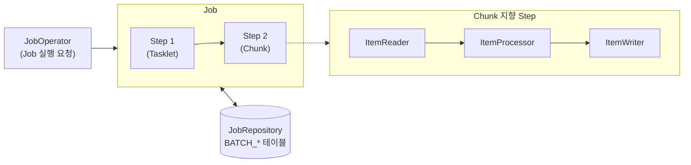
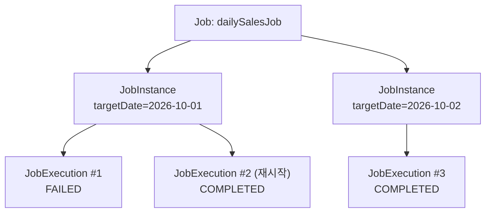

# 01. Spring Batch 소개

## 학습 목표

- 배치(Batch) 처리가 무엇이고 언제 필요한지 이해한다.
- Spring Batch 의 핵심 구성 요소(Job, Step, JobRepository ...)를 그림으로 설명할 수 있다.
- Spring Batch 6.x (Spring Boot 4) 에서 달라진 점을 알고, 오래된 예제를 걸러 볼 수 있다.

---

## 1. 배치 처리란?

**배치 처리**는 사용자의 요청 없이, 정해진 시점에 **대량의 데이터를 한 번에 처리**하는 작업입니다.

| 구분 | 온라인(API) 처리 | 배치 처리 |
|------|------------------|-----------|
| 시작 | 사용자의 요청 | 스케줄(매일 새벽 2시 등), 이벤트, 수동 실행 |
| 처리량 | 요청 1건 | 수천 ~ 수억 건 |
| 응답 | 즉시 (ms) | 수 분 ~ 수 시간 |
| 실패 시 | 요청을 다시 보냄 | **실패한 지점부터 다시 실행**해야 함 |

대표적인 예:

- 매일 자정, 어제 주문을 집계해서 **일별 매출 테이블**을 만든다. (07장)
- 매월 1일, 고객의 누적 구매 금액으로 **회원 등급**을 다시 매긴다. (06장)
- 협력사가 보내준 **CSV 파일을 DB 에 적재**한다. (05장, 08장)

### 직접 만들면 무엇이 어려운가?

`for` 문으로 데이터를 읽어서 저장하면 될 것 같지만, 실제로는 다음 문제가 생깁니다.

1. **메모리**: 1,000만 건을 한 번에 `List` 로 읽으면 OOM 이 납니다.
2. **트랜잭션**: 1,000만 건을 하나의 트랜잭션으로 묶으면 실패 시 전부 롤백되고, 건마다 커밋하면 너무 느립니다.
3. **재시작**: 800만 건째에서 실패했다면, 처음부터가 아니라 800만 건째부터 다시 하고 싶습니다.
4. **불량 데이터**: 잘못된 데이터 몇 건 때문에 전체 작업이 멈추면 안 됩니다.
5. **이력 관리**: 언제, 어떤 파라미터로 실행했고, 몇 건을 처리했는지 기록이 남아야 합니다.

**Spring Batch 는 이 문제들에 대한 검증된 해답을 프레임워크로 제공합니다.**

| 문제 | Spring Batch 의 해답 | 배우는 장 |
|------|----------------------|-----------|
| 메모리 | Chunk 단위 처리 (N건씩 읽고-가공하고-쓰기) | 05 |
| 트랜잭션 | Chunk 마다 커밋 | 05 |
| 재시작 | JobRepository 에 진행 상태 저장, ItemStream | 04, 06, 10 |
| 불량 데이터 | Skip / Retry | 08 |
| 이력 관리 | 메타데이터 테이블 (BATCH_*) | 04 |

---

## 2. 핵심 구성 요소



| 구성 요소 | 설명 | 비유 |
|-----------|------|------|
| **Job** | 하나의 배치 작업 전체. 1개 이상의 Step 으로 구성 | "일별 매출 집계" 라는 업무 |
| **Step** | Job 을 구성하는 독립적인 처리 단계 | "집계하기", "리포트 만들기" |
| **Tasklet** | Step 안에서 한 번 실행되는 단순 작업 | 테이블 비우기, 파일 이동 |
| **Chunk** | N건씩 읽기 -> 가공 -> 쓰기를 반복하는 Step 방식 | 택배를 10개씩 묶어 배송 |
| **ItemReader** | 데이터를 1건씩 읽음 (파일, DB, API ...) | |
| **ItemProcessor** | 1건을 가공/검증/필터링 (선택) | |
| **ItemWriter** | Chunk 단위(N건)로 한 번에 저장 | |
| **JobRepository** | 실행 이력/상태를 저장하는 저장소 | 작업 일지 |
| **JobOperator** | Job 을 시작/중지/재시작하는 진입점 | |

### 실행 단위: JobInstance 와 JobExecution



- **JobInstance** = Job + 식별 파라미터(JobParameters). "2026-10-01 일자 매출 집계" 라는 논리적 실행 단위.
- **JobExecution** = JobInstance 를 실제로 실행한 1번의 시도. 실패 후 재시작하면 Execution 이 하나 더 생깁니다.
- **이미 COMPLETED 된 JobInstance 는 다시 실행할 수 없습니다.** (중복 집계 방지) -> 04장에서 직접 확인합니다.

---

## 3. Spring Batch 6 (Spring Boot 4) 에서 달라진 점

인터넷의 많은 예제는 Spring Batch 4.x / 5.x 기준입니다. 아래 차이를 알면 오래된 예제를 걸러 볼 수 있습니다.

| 항목 | 예전 (4.x / 5.x) | 지금 (6.x, 이 강의) |
|------|------------------|---------------------|
| Builder | `JobBuilderFactory`, `StepBuilderFactory` (4.x) | `new JobBuilder(name, jobRepository)`, `new StepBuilder(name, jobRepository)` |
| Chunk 설정 | `.chunk(10, transactionManager)` | `.chunk(10).transactionManager(tm)` (새 `ChunkOrientedStep`) <br/> 기존 방식은 deprecated(forRemoval) |
| 패키지 | `org.springframework.batch.item.*`, `org.springframework.batch.core.*` | `org.springframework.batch.infrastructure.item.*`, `org.springframework.batch.core.job.*`, `...core.step.*` 등으로 재구성 |
| Job 실행 | `JobLauncher` | `JobOperator` (JobLauncher 는 deprecated) |
| 테스트 | `JobLauncherTestUtils` | `JobOperatorTestUtils` |
| Retry | spring-retry 라이브러리 | Spring Framework 7 의 `org.springframework.core.retry` |
| Boot Starter | `spring-boot-starter-batch` 하나 | `spring-boot-starter-batch` (메타데이터를 DB 에 저장하지 않음) <br/> `spring-boot-starter-batch-jdbc` (JDBC JobRepository, **이 강의에서 사용**) |
| `@EnableBatchProcessing` | 4.x 에서는 필수 | Spring Boot 에서는 **붙이지 않는다** (붙이면 Boot 자동 구성이 꺼짐) |

> 이 강의의 코드는 모두 Spring Batch 6.0.5 / Spring Boot 4.1.1 에서 컴파일과 테스트를 마쳤습니다.

---

## 4. 왜 jOOQ 인가? (JPA 가 아닌 이유)

이 강의는 DB 접근에 **jOOQ** 를 사용합니다.

| 선택지 | 배치에서의 장단점 |
|--------|-------------------|
| JPA (Hibernate) | 영속성 컨텍스트, 더티 체킹, 지연 로딩 등 **온라인 처리용 기능이 대량 처리에서는 오버헤드**. 벌크 연산/집계 쿼리가 불편 |
| JdbcTemplate / JdbcClient | 가볍고 빠르지만 SQL 이 문자열이라 **컬럼명 오타, 타입 불일치를 런타임에야 발견** |
| MyBatis | XML 매핑 관리 부담 |
| **jOOQ** | SQL 을 그대로 Java 코드로 작성. **스키마에서 생성한 코드로 컴파일 타임에 검증**. `GROUP BY`, `ON CONFLICT`(UPSERT), 윈도우 함수 등 DB 기능을 그대로 사용 |

배치는 "집계 / 대량 INSERT / 대량 UPDATE" 가 대부분이라 **SQL 을 잘 다루는 도구**가 유리합니다.
jOOQ 는 Spring 트랜잭션에 그대로 참여하므로 Spring Batch 의 Chunk 트랜잭션과도 자연스럽게 맞물립니다.

```java
// 컬럼 이름/타입이 틀리면 컴파일 에러가 난다.
dsl.select(ORDERS.STATUS, count(), sum(ORDERS.AMOUNT))
   .from(ORDERS)
   .where(ORDERS.ORDERED_AT.ge(targetDate.atStartOfDay()))
   .groupBy(ORDERS.STATUS)
   .fetch();
```

> Spring Batch 는 jOOQ 전용 ItemReader/Writer 를 제공하지 않습니다.
> 그래서 이 강의에서는 직접 만든 `JooqPagingItemReader` 와 jOOQ 기반 Writer 를 사용하고, 그 과정에서 Reader/Writer 의 동작 원리도 함께 배웁니다.

---

## 정리

- 배치는 **대량 데이터를 안정적으로** 처리하는 작업이고, Spring Batch 는 Chunk / 트랜잭션 / 재시작 / Skip / 이력 관리를 제공한다.
- **Job** 은 여러 **Step** 으로, Step 은 **Tasklet** 또는 **Chunk(Reader-Processor-Writer)** 로 구성된다.
- **JobInstance = Job + 식별 파라미터**, **JobExecution = 1번의 실행 시도**.
- Spring Batch 6 에서는 패키지, Chunk 설정, JobOperator 등이 바뀌었으므로 예제를 볼 때 버전을 확인하자.

## 확인 문제

1. 1,000만 건을 처리하다 실패했을 때 처음부터 다시 하지 않으려면 무엇이 필요할까?
2. `targetDate=2026-10-01` 로 성공한 Job 을 같은 파라미터로 다시 실행하면 어떻게 될까?
3. Tasklet 과 Chunk 방식은 각각 어떤 작업에 어울릴까?

---

[← 이전: README (목차)](../README.md) | [목차](../README.md) | [다음: 02. 프로젝트 구성 →](02-project-setup.md)
