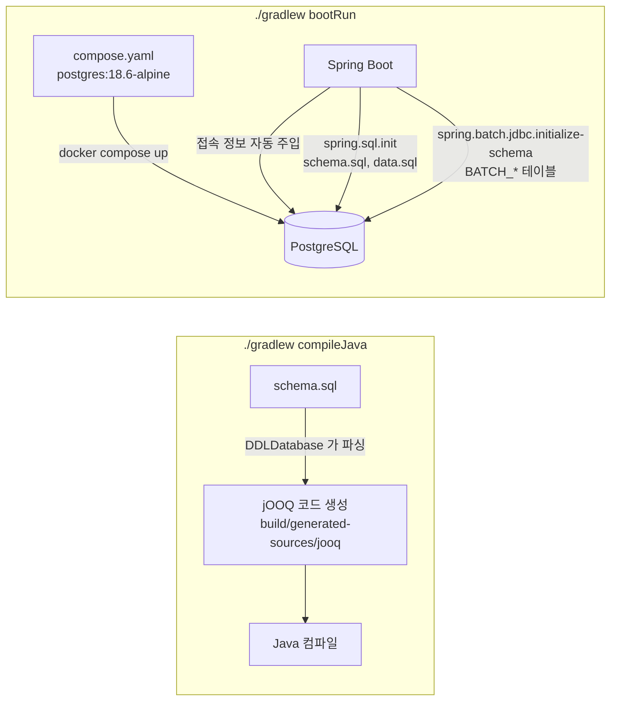
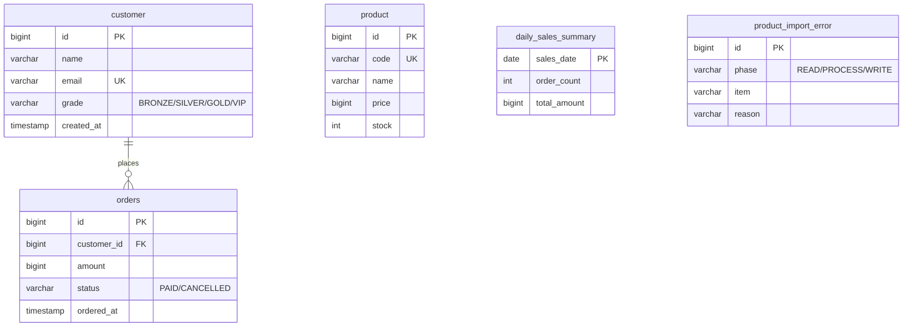

# 02. 프로젝트 구성

## 학습 목표

- Spring Boot 4 + Spring Batch 6 + jOOQ 프로젝트의 `build.gradle.kts` 를 읽을 수 있다.
- Docker Compose 로 PostgreSQL 을 띄우고, Spring Boot 가 자동으로 연결하는 원리를 이해한다.
- `schema.sql` / `data.sql` 로 실습 데이터를 준비하고, jOOQ 코드 생성 흐름을 이해한다.

---

## 1. 전체 그림



핵심은 두 가지입니다.

1. **`schema.sql` 하나가 두 가지 역할**을 합니다. 실행 시에는 테이블을 만들고, 빌드 시에는 jOOQ 코드 생성의 입력이 됩니다. 그래서 **코드 생성에 DB 가 필요 없습니다.**
2. **`./gradlew bootRun` 만 하면 DB 가 자동으로 뜹니다.** (`spring-boot-docker-compose`)

---

## 2. build.gradle.kts

[`build.gradle.kts`](../build.gradle.kts) 의 핵심 부분입니다.

```kotlin
plugins {
    java
    jacoco
    id("org.springframework.boot") version "4.1.1"
    id("io.spring.dependency-management") version "1.1.7"
    id("org.jooq.jooq-codegen-gradle") version "3.21.7"   // jOOQ 공식 코드 생성 플러그인
}

java {
    toolchain {
        languageVersion = JavaLanguageVersion.of(25)       // Java 25
    }
}
```

> `settings.gradle.kts` 의 `foojay-resolver-convention` 플러그인 덕분에, 로컬에 Java 25 가 없으면 Gradle 이 자동으로 내려받습니다.

### 의존성

```kotlin
dependencies {
    implementation("org.springframework.boot:spring-boot-starter-batch-jdbc") // Spring Batch + JDBC JobRepository
    implementation("org.springframework.boot:spring-boot-starter-jooq")       // jOOQ DSLContext 자동 구성
    runtimeOnly("org.postgresql:postgresql")
    developmentOnly("org.springframework.boot:spring-boot-docker-compose")    // bootRun 시 compose.yaml 자동 실행

    jooqCodegen("org.jooq:jooq-meta-extensions:$jooqVersion")                 // schema.sql 파싱용

    testImplementation("org.springframework.boot:spring-boot-starter-batch-jdbc-test")
    testImplementation("org.springframework.boot:spring-boot-starter-jooq-test")
    testImplementation("org.springframework.boot:spring-boot-testcontainers")
    testImplementation("org.testcontainers:testcontainers-junit-jupiter")
    testImplementation("org.testcontainers:testcontainers-postgresql")
}
```

| 의존성 | 역할 |
|--------|------|
| `spring-boot-starter-batch-jdbc` | Spring Boot 4 에서는 starter 가 나뉘었습니다. `-jdbc` 를 써야 **메타데이터가 DB(BATCH_* 테이블)에 저장**됩니다. |
| `spring-boot-starter-jooq` | `DSLContext` 빈을 만들고, **Spring 트랜잭션에 참여**하도록 설정하며, SQL 예외를 Spring 의 `DataAccessException` 으로 변환합니다. |
| `spring-boot-docker-compose` | `developmentOnly` 이므로 `bootRun` 에서만 동작하고, 테스트/배포 jar 에는 포함되지 않습니다. |

### jOOQ 코드 생성 설정

```kotlin
jooq {
    configuration {
        generator {
            database {
                name = "org.jooq.meta.extensions.ddl.DDLDatabase"   // DB 대신 DDL 스크립트를 읽는다
                properties {
                    property { key = "scripts";           value = "src/main/resources/schema.sql" }
                    property { key = "sort";              value = "semantic" }
                    property { key = "unqualifiedSchema"; value = "none" }
                    property { key = "defaultNameCase";   value = "lower" }  // PostgreSQL 처럼 소문자
                }
            }
            target {
                packageName = "com.example.batch.jooq"
                directory = "build/generated-sources/jooq"
            }
        }
    }
}

tasks.named("compileJava") { dependsOn(tasks.named("jooqCodegen")) }  // 컴파일 전에 항상 코드 생성
```

생성된 코드는 `build/generated-sources/jooq/com/example/batch/jooq` 에 있습니다.

```
com.example.batch.jooq
├── Tables.java                 # CUSTOMER, ORDERS, PRODUCT ... 상수
└── tables
    ├── Customer.java           # CUSTOMER.ID, CUSTOMER.NAME, CUSTOMER.GRADE ...
    ├── Orders.java
    └── records/CustomerRecord.java ...
```

> **DDLDatabase vs 실제 DB 연결**: 실무에서는 Flyway 로 마이그레이션한 DB(또는 Testcontainers)에 접속해서 코드를 생성하기도 합니다.
> 이 강의는 "DB 없이도 빌드된다"는 단순함을 위해 DDLDatabase 를 사용합니다.

---

## 3. Docker Compose 로 PostgreSQL 띄우기

[`compose.yaml`](../compose.yaml)

```yaml
services:
  postgres:
    image: 'postgres:18.6-alpine'
    container_name: hello-batch-postgres
    environment:
      POSTGRES_DB: batch
      POSTGRES_USER: batch
      POSTGRES_PASSWORD: batch
      TZ: Asia/Seoul
    ports:
      - '5432:5432'
    volumes:
      - postgres-data:/var/lib/postgresql   # PostgreSQL 18 부터는 이 경로를 마운트
```

- **PostgreSQL 18.6** 은 작성 시점(2026-10) 기준 최신 안정 버전입니다. (19 는 아직 beta)
- **PostgreSQL 18 이미지부터 데이터 디렉토리(PGDATA)가 `/var/lib/postgresql/18/docker` 로 바뀌었습니다.** 예전 예제처럼 `/var/lib/postgresql/data` 를 마운트하지 말고 상위 디렉토리를 마운트합니다.

### Spring Boot 가 자동으로 연결하는 원리

`spring-boot-docker-compose` 가 있으면 `bootRun` 시점에:

1. 프로젝트 루트의 `compose.yaml` 을 찾아 `docker compose up` 을 실행하고
2. 컨테이너가 준비될 때까지 기다린 다음
3. 이미지 이름(`postgres`)과 환경 변수를 보고 **DataSource 접속 정보를 자동으로 만들어 줍니다.** (`ServiceConnection`)

```yaml
# application.yml
spring:
  docker:
    compose:
      lifecycle-management: start-only   # 앱이 끝나도 컨테이너는 계속 띄워둔다
```

배치 애플리케이션은 Job 이 끝나면 바로 종료되므로, 매번 컨테이너를 내렸다 올리지 않도록 `start-only` 로 설정했습니다.

```bash
docker compose ps             # 상태 확인
docker compose down           # 컨테이너 종료 (데이터 유지)
docker compose down -v        # 볼륨까지 삭제 (BATCH_* 메타데이터까지 완전 초기화)
```

---

## 4. application.yml

[`src/main/resources/application.yml`](../src/main/resources/application.yml)

```yaml
spring:
  datasource:                       # docker compose 로 띄우면 자동으로 덮어쓰인다
    url: jdbc:postgresql://localhost:5432/batch
    username: batch
    password: batch
  sql:
    init:
      mode: always                  # 기동할 때마다 schema.sql, data.sql 실행
  jooq:
    sql-dialect: postgres
  batch:
    jdbc:
      initialize-schema: always     # BATCH_* 메타데이터 테이블 생성
    job:
      name: helloJob                # 기동 시 실행할 Job (기본값)
```

| 설정 | 의미 |
|------|------|
| `spring.sql.init.mode=always` | 내장 DB(H2 등)가 아니어도 `schema.sql` / `data.sql` 을 실행합니다. |
| `spring.batch.jdbc.initialize-schema=always` | Spring Batch 가 자체 DDL 로 메타데이터 테이블을 만듭니다. 이미 있으면 생성 에러는 무시됩니다. (`continue-on-error` 기본값 true) |
| `spring.batch.job.name` | 컨텍스트에 Job 이 여러 개면 무엇을 실행할지 지정해야 합니다. 실행 시 `--spring.batch.job.name=xxx` 로 바꿉니다. |
| `spring.batch.job.enabled` | 기본값 `true`. 기동 시 Job 을 자동 실행합니다. (테스트에서는 `false`) |

> **운영 환경에서는** `spring.sql.init.mode=always` 와 `initialize-schema=always` 를 쓰지 않습니다.
> 스키마는 Flyway/Liquibase 등으로 관리하고 메타데이터 테이블도 미리 만들어 둡니다.

---

## 5. 실습 데이터: schema.sql / data.sql

### schema.sql

[`src/main/resources/schema.sql`](../src/main/resources/schema.sql) 은 매번 테이블을 지우고 다시 만듭니다.



> Spring Batch 메타데이터 테이블(BATCH_*)은 `schema.sql` 에 넣지 않습니다. 매번 지워지면 실행 이력이 사라지기 때문입니다.

### data.sql

[`src/main/resources/data.sql`](../src/main/resources/data.sql) 은 고객 20명과 주문 300건을 넣습니다.
주문은 PostgreSQL 의 `generate_series` 와 산술식으로 만들어서 **실행할 때마다 똑같은 데이터**가 나옵니다.

```sql
INSERT INTO orders (customer_id, amount, status, ordered_at)
SELECT (i % 20) + 1,
       ((i * 7919) % 97 + 1) * 1000 * CASE WHEN (i % 20) + 1 <= 3 THEN 4 WHEN (i % 20) + 1 <= 8 THEN 2 ELSE 1 END,
       CASE WHEN i % 10 = 0 THEN 'CANCELLED' ELSE 'PAID' END,
       TIMESTAMP '2026-10-01 00:00:00' + (i % 7) * INTERVAL '1 day' + (i % 24) * INTERVAL '1 hour' + ...
FROM generate_series(1, 300) AS s(i);
```

---

## 6. 실습: 프로젝트 빌드하고 DB 확인하기

### 6-1. 빌드 (jOOQ 코드 생성 포함)

```bash
./gradlew compileJava
ls build/generated-sources/jooq/com/example/batch/jooq/tables
# Customer.java  DailySalesSummary.java  Orders.java  Product.java  ProductImportError.java  records
```

### 6-2. 애플리케이션 실행

```bash
./gradlew bootRun
```

처음에는 PostgreSQL 이미지를 받느라 시간이 조금 걸립니다. `helloJob` 이 실행되고 프로세스가 종료됩니다.

### 6-3. DB 접속해서 확인

```bash
docker exec -it hello-batch-postgres psql -U batch -d batch
```

```sql
\dt
-- batch_job_execution, batch_job_instance, ... (Spring Batch 메타데이터)
-- customer, orders, product, daily_sales_summary, product_import_error (도메인)

SELECT date(ordered_at) AS day, status, count(*), sum(amount)
FROM orders GROUP BY 1, 2 ORDER BY 1, 2;
```

### 6-4. IDE 에서 실행하기 (IntelliJ)

1. Gradle 프로젝트로 열기 -> Gradle JVM / Project SDK 를 Java 25 로 지정
2. `./gradlew compileJava` 를 한 번 실행해 jOOQ 코드를 생성
3. `HelloSpringBatchApplication` 실행 구성의 Program arguments 에 `--spring.batch.job.name=helloJob`

---

## 정리

- `schema.sql` 하나로 **테이블 생성 + jOOQ 코드 생성**을 모두 해결한다. (DDLDatabase)
- `spring-boot-docker-compose` 로 `bootRun` 시 **PostgreSQL 이 자동 기동/연결**된다.
- 도메인 테이블은 매 기동 시 초기화되지만, **BATCH_* 메타데이터는 계속 쌓인다.**

## 확인 문제

1. `schema.sql` 에 컬럼을 추가하면 Java 코드에서 그 컬럼을 쓰기 위해 무엇을 해야 할까?
2. `spring-boot-docker-compose` 를 `developmentOnly` 로 선언한 이유는?
3. `docker compose down` 과 `docker compose down -v` 의 차이는?

---

[← 이전: 01. Spring Batch 소개](01-spring-batch-introduction.md) | [목차](../README.md) | [다음: 03. 첫 번째 Job: Tasklet →](03-first-job-tasklet.md)
