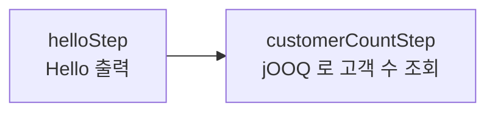
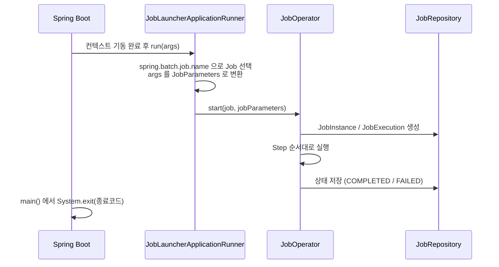

# 03. 첫 번째 Job: Tasklet

## 학습 목표

- `JobBuilder` / `StepBuilder` 로 Job 과 Step 을 빈으로 등록할 수 있다.
- Tasklet 이 무엇이고 `RepeatStatus` 가 어떤 의미인지 이해한다.
- Spring Boot 가 기동 시 Job 을 실행하는 흐름을 이해한다.

실습 코드: [`lesson03/HelloJobConfig.java`](../src/main/java/com/example/batch/lesson03/HelloJobConfig.java)

---

## 1. 만들 Job



---

## 2. Job 정의

```java
@Configuration
public class HelloJobConfig {

    @Bean
    public Job helloJob(JobRepository jobRepository,
                        Step helloStep,
                        Step customerCountStep,
                        JobSummaryListener jobSummaryListener) {
        return new JobBuilder("helloJob", jobRepository)   // (1) Job 이름 + JobRepository
                .incrementer(new RunIdIncrementer())        // (2) 실행할 때마다 run.id 증가
                .listener(jobSummaryListener)               // (3) 시작/종료 로그
                .start(helloStep)                           // (4) 첫 번째 Step
                .next(customerCountStep)                    //     두 번째 Step
                .build();
    }
```

1. **Job 이름**은 메타데이터 테이블(`BATCH_JOB_INSTANCE.JOB_NAME`)에 저장되고, `--spring.batch.job.name` 으로 실행할 때 쓰입니다.
   `JobRepository` 는 Spring Boot 가 자동으로 만들어 주므로 주입만 받습니다.
2. **`RunIdIncrementer`**: 파라미터 없이 실행해도 매번 `run.id=1, 2, 3...` 을 붙여서 새로운 JobInstance 로 실행되게 합니다. 자세한 이유는 04장에서 다룹니다.
   > **Spring Batch 6 주의**: incrementer 가 있는 Job 은 실행할 때 넘긴 JobParameters 가 **무시**됩니다.
   > (`JobOperator.start()` 가 경고 로그 `Additional parameters will be ignored` 를 남기고 `startNextInstance()` 로 실행)
   > 그래서 파라미터가 필요한 Job 에는 incrementer 를 쓰지 않습니다. (04장, 05장)
3. **`JobExecutionListener`**: Job 전후에 공통 로직을 넣습니다. [`JobSummaryListener`](../src/main/java/com/example/batch/common/JobSummaryListener.java) 는 Step 별 처리 건수를 출력합니다.
4. **`start()` / `next()`**: Step 을 순서대로 실행합니다. 앞 Step 이 실패하면 뒤 Step 은 실행되지 않습니다.

---

## 3. Tasklet Step 정의

```java
    @Bean
    public Step helloStep(JobRepository jobRepository, PlatformTransactionManager transactionManager) {
        return new StepBuilder("helloStep", jobRepository)
                .tasklet((contribution, chunkContext) -> {
                    log.info("Hello, Spring Batch!");
                    return RepeatStatus.FINISHED;
                }, transactionManager)
                .build();
    }

    @Bean
    public Step customerCountStep(JobRepository jobRepository,
                                  PlatformTransactionManager transactionManager,
                                  DSLContext dsl) {
        return new StepBuilder("customerCountStep", jobRepository)
                .tasklet((contribution, chunkContext) -> {
                    int customerCount = dsl.fetchCount(CUSTOMER);   // SELECT count(*) FROM customer
                    log.info("현재 등록된 고객 수: {}명", customerCount);
                    return RepeatStatus.FINISHED;
                }, transactionManager)
                .build();
    }
```

### Tasklet 이란?

```java
@FunctionalInterface
public interface Tasklet {
    RepeatStatus execute(StepContribution contribution, ChunkContext chunkContext) throws Exception;
}
```

- Step 안에서 **하나의 트랜잭션으로 실행되는 작업 단위**입니다. 람다로 바로 쓸 수 있습니다.
- `transactionManager` 로 지정한 트랜잭션 안에서 실행됩니다. 예외가 나면 롤백되고 Step 은 FAILED 가 됩니다.
- 반환값 `RepeatStatus`:

| 값 | 의미 |
|----|------|
| `FINISHED` | 작업 끝. Step 종료 |
| `CONTINUABLE` | `execute()` 를 **다시 호출**한다 (매 호출마다 트랜잭션이 새로 시작). 직접 반복 처리를 구현할 때 사용 |

### 언제 Tasklet 을 쓰나?

| Tasklet 에 어울리는 작업 | Chunk 에 어울리는 작업 (05장) |
|--------------------------|-------------------------------|
| 테이블 비우기, 임시 파일 삭제 | 대량 데이터 읽고-가공하고-쓰기 |
| 한 방 SQL 로 끝나는 집계 (`INSERT ... SELECT`) | 건별로 비즈니스 로직이 필요한 처리 |
| 외부 API 1회 호출, 알림 발송 | 파일 <-> DB 변환 |

---

## 4. Spring Boot 는 Job 을 어떻게 실행할까?



- Spring Boot 는 `spring-boot-starter-batch` 가 있으면 `JobLauncherApplicationRunner` 를 등록합니다.
- 컨텍스트가 다 뜬 뒤 `spring.batch.job.name` 의 Job 을 실행합니다.
- **`@EnableBatchProcessing` 은 붙이지 않습니다.** 붙이면 Boot 의 자동 구성(이 Runner 포함)이 꺼집니다.

[`HelloSpringBatchApplication`](../src/main/java/com/example/batch/HelloSpringBatchApplication.java) 의 `main` 은 Job 결과를 **프로세스 종료 코드**로 돌려줍니다.
Jenkins, cron, Kubernetes CronJob 같은 스케줄러는 이 종료 코드로 성공/실패를 판단합니다.

```java
System.exit(SpringApplication.exit(SpringApplication.run(HelloSpringBatchApplication.class, args)));
```

---

## 5. 실습

### 5-1. 실행

```bash
./gradlew bootRun --args='--spring.batch.job.name=helloJob'
```

```
>>> [helloJob] 시작 - parameters={JobParameter{name='run.id', value=1, type=class java.lang.Long, identifying=true}}
Hello, Spring Batch!
현재 등록된 고객 수: 20명
<<< [helloJob] 종료 - status=COMPLETED, exitStatus=COMPLETED, elapsed=240ms
    - step=helloStep status=COMPLETED read=0 filter=0 write=0 skip=0 commit=1 rollback=0
    - step=customerCountStep status=COMPLETED read=0 filter=0 write=0 skip=0 commit=1 rollback=0
```

### 5-2. 한 번 더 실행해 보기

같은 명령을 다시 실행하면 `run.id=2` 로 실행됩니다. `RunIdIncrementer` 덕분입니다.

### 5-3. 실패시켜 보기

`helloStep` 의 람다 안에 `throw new IllegalStateException("일부러 실패");` 를 넣고 실행해 보세요.

- `helloStep` 은 FAILED, `customerCountStep` 은 **실행되지 않습니다.**
- Job 은 FAILED 로 끝나고, 프로세스 종료 코드가 0 이 아닙니다. (`echo $?` 로 확인)

확인했으면 코드를 원래대로 돌려 놓습니다.

---

## 정리

- Job 은 `new JobBuilder(이름, jobRepository)`, Step 은 `new StepBuilder(이름, jobRepository)` 로 만든다.
- **Tasklet** 은 Step 에서 한 번(또는 CONTINUABLE 이면 반복) 실행되는 단순 작업이고, 트랜잭션 안에서 실행된다.
- Spring Boot 는 기동 후 `spring.batch.job.name` 의 Job 을 자동 실행한다. `@EnableBatchProcessing` 은 쓰지 않는다.

## 확인 문제

1. `RepeatStatus.CONTINUABLE` 을 반환하면 어떤 일이 생길까? 무한 루프를 막으려면?
2. 두 번째 Step 에서 예외가 발생하면 첫 번째 Step 에서 한 작업은 롤백될까? (힌트: 트랜잭션 범위는 Step 단위)
3. `RunIdIncrementer` 를 빼고 두 번 실행하면 어떻게 될지 예상해 보자. (04장에서 확인)

---

[← 이전: 02. 프로젝트 구성](02-project-setup.md) | [목차](../README.md) | [다음: 04. JobParameters 와 메타데이터 →](04-job-parameters-and-metadata.md)
