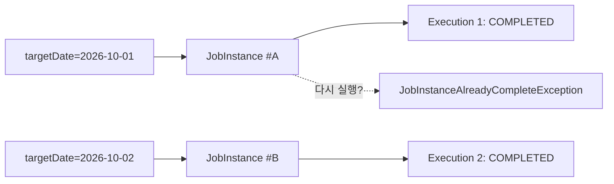
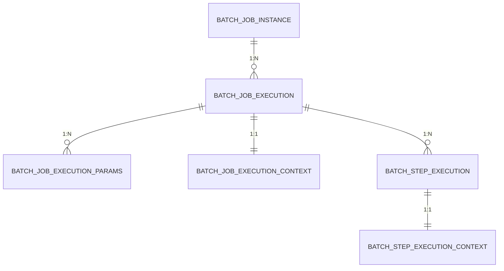

# 04. JobParameters 와 메타데이터

## 학습 목표

- JobParameters 를 전달하고 `@StepScope` 로 주입받을 수 있다. (Late Binding)
- JobInstance / JobExecution 이 어떻게 구분되는지, 왜 같은 파라미터로 재실행이 안 되는지 이해한다.
- `JobParametersValidator` 로 필수 파라미터를 검증할 수 있다.
- 메타데이터 테이블(BATCH_*)을 직접 조회해서 실행 이력을 확인할 수 있다.

실습 코드:
[`lesson04/ParameterJobConfig.java`](../src/main/java/com/example/batch/lesson04/ParameterJobConfig.java),
[`lesson04/OrderStatTasklet.java`](../src/main/java/com/example/batch/lesson04/OrderStatTasklet.java)

---

## 1. 만들 Job

`targetDate` 파라미터를 받아 해당 날짜의 주문 통계(상태별 건수, 금액)를 출력합니다.

```java
@Bean
public Job parameterJob(JobRepository jobRepository, Step orderStatStep, JobSummaryListener listener) {
    return new JobBuilder("parameterJob", jobRepository)
            .validator(new DefaultJobParametersValidator(
                    new String[]{"targetDate"},   // 필수 키
                    new String[]{}))              // 선택 키
            .listener(listener)
            .start(orderStatStep)
            .build();
}
```

이번에는 **`incrementer` 를 일부러 넣지 않았습니다.** 그래야 JobInstance 의 동작을 관찰할 수 있습니다.

---

## 2. JobParameters 전달하기

Spring Boot 에서는 **`--` 가 없는 인자**가 JobParameters 가 됩니다.

```bash
./gradlew bootRun --args='--spring.batch.job.name=parameterJob targetDate=2026-10-01,java.time.LocalDate'
#                         └─ Spring 설정 (-- 있음)        └─ JobParameter (-- 없음)
```

형식: **`이름=값,타입,식별여부`**

| 예 | 의미 |
|----|------|
| `targetDate=2026-10-01,java.time.LocalDate` | LocalDate 타입, 식별 파라미터(기본값 true) |
| `count=10,java.lang.Long` | Long 타입 |
| `name=hello` | 타입 생략 시 String |
| `requestedBy=batch-admin,java.lang.String,false` | **식별에 쓰지 않는** 파라미터 |

> 지원 타입: String, Long, Integer, Double, LocalDate, LocalTime, LocalDateTime, Date 등

코드에서 직접 만들 때는 `JobParametersBuilder` 를 씁니다. (09장 테스트에서 사용)

```java
new JobParametersBuilder()
        .addLocalDate("targetDate", LocalDate.of(2026, 10, 1))
        .addString("requestedBy", "batch-admin", false)   // 식별에 쓰지 않음
        .toJobParameters();
```

---

## 3. @StepScope 와 Late Binding

```java
@Component
@StepScope
public class OrderStatTasklet implements Tasklet {

    private final DSLContext dsl;
    private final LocalDate targetDate;

    public OrderStatTasklet(DSLContext dsl,
                            @Value("#{jobParameters['targetDate']}") LocalDate targetDate) {
        this.dsl = dsl;
        this.targetDate = targetDate;
    }

    @Override
    public RepeatStatus execute(StepContribution contribution, ChunkContext chunkContext) {
        var result = dsl.select(ORDERS.STATUS, count(), coalesce(sum(ORDERS.AMOUNT), BigDecimal.ZERO))
                .from(ORDERS)
                .where(ORDERS.ORDERED_AT.ge(targetDate.atStartOfDay()))
                .and(ORDERS.ORDERED_AT.lt(targetDate.plusDays(1).atStartOfDay()))
                .groupBy(ORDERS.STATUS)
                .orderBy(ORDERS.STATUS)
                .fetch();
        ...
    }
}
```

일반 싱글톤 빈은 **애플리케이션 기동 시점**에 만들어지는데, 그때는 아직 JobParameters 가 없습니다.

| Scope | 빈이 만들어지는 시점 | 주입 가능한 값 |
|-------|----------------------|----------------|
| (기본) singleton | 애플리케이션 기동 시 | - |
| `@JobScope` | Job 실행 시작 시 | `#{jobParameters[...]}`, `#{jobExecutionContext[...]}` |
| `@StepScope` | **Step 실행 시작 시** | 위 + `#{stepExecutionContext[...]}` |

`@StepScope` 빈은 프록시로 등록되어 있다가 **Step 이 실행될 때 진짜 객체가 만들어지고**, 그때 SpEL 로 파라미터를 주입받습니다.
이를 **Late Binding** 이라고 합니다. Step 이 끝나면 빈도 사라지므로, Step 마다 독립적인 상태를 가질 수 있습니다.

> SQL 을 문자열로 만들 필요 없이 jOOQ 조건식(`ORDERS.ORDERED_AT.ge(...)`)에 `LocalDate` 를 그대로 쓸 수 있습니다.
> 날짜 범위는 `ordered_at >= 당일 0시 AND ordered_at < 다음날 0시` 로 비교해야 인덱스(`idx_orders_ordered_at`)를 탈 수 있습니다.

---

## 4. JobInstance 와 JobExecution



- **JobInstance = Job 이름 + 식별 파라미터(identifying=true) 의 조합**
- 같은 JobInstance 가 이미 **COMPLETED** 이면 다시 실행할 수 없습니다. -> "같은 날짜의 정산이 두 번 도는 사고"를 프레임워크가 막아 줍니다.
- **FAILED** 인 JobInstance 는 같은 파라미터로 다시 실행하면 **재시작(restart)** 됩니다. (새 JobExecution 생성)

### 그럼 helloJob 은 어떻게 매번 실행됐을까?

`RunIdIncrementer` 가 이전 실행의 `run.id` 에 1을 더한 값을 파라미터에 넣어 주기 때문에, 매번 **다른 JobInstance** 가 됩니다.

### Spring Batch 6 에서 꼭 알아야 할 incrementer 동작

Spring Batch 6 의 `JobOperator.start(job, parameters)` 는 **Job 에 incrementer 가 있으면 전달받은 파라미터를 버리고** `startNextInstance(job)` 를 호출합니다.

```java
// SimpleJobOperator (Spring Batch 6.0.5)
if (job.getJobParametersIncrementer() != null) {
    logger.warn("... defines an incrementer with additional parameters: [...]. Additional parameters will be ignored.");
    return startNextInstance(job);
}
return run(job, jobParameters);
```

Spring Boot 의 Job 실행기도 `JobOperator.start()` 를 쓰므로, 결과적으로:

| | incrementer 있음 | incrementer 없음 |
|---|---|---|
| 실행 시 넘긴 파라미터 | **무시됨** | 그대로 사용 |
| 매 실행 | 항상 새 JobInstance | 파라미터가 같으면 같은 JobInstance |
| 실패 후 다시 실행 | 새 JobInstance 로 **처음부터** | 같은 JobInstance 를 **실패 지점부터 재시작** |
| 어울리는 Job | 파라미터가 필요 없고 매번 전체를 다시 계산 (03장 helloJob, 06장 고객 등급) | 기준일/입력 파일이 있는 Job (04장, 05장, 07장, 08장) |

> 정리하면 **"무엇을 처리하는가"(날짜, 파일)가 곧 JobInstance 의 식별자**가 되도록 파라미터를 설계하고,
> incrementer 는 정말로 "매번 새로" 실행하는 Job 에만 씁니다.

---

## 5. 실습

### 5-1. 정상 실행

```bash
./gradlew bootRun --args='--spring.batch.job.name=parameterJob targetDate=2026-10-01,java.time.LocalDate'
```

```
>>> [parameterJob] 시작 - parameters={JobParameter{name='targetDate', value=2026-10-01, type=class java.time.LocalDate, identifying=true}}
[2026-10-01] 주문 통계
  status=CANCELLED count=4 amount=668000
  status=PAID count=38 amount=3102000
<<< [parameterJob] 종료 - status=COMPLETED, exitStatus=COMPLETED
```

### 5-2. 같은 파라미터로 다시 실행

같은 명령을 한 번 더 실행합니다.

```
Caused by: org.springframework.batch.core.launch.JobInstanceAlreadyCompleteException:
  A job instance already exists and is complete for identifying parameters={...targetDate, value=2026-10-01...}.
  If you want to run this job again, change the parameters.
```

> `data.sql` 로 도메인 데이터는 초기화되지만 **BATCH_* 테이블은 그대로**이기 때문에 "이미 완료된 실행"이 기억되고 있습니다.

### 5-3. 다른 날짜로 실행

`targetDate=2026-10-02,java.time.LocalDate` 로 바꾸면 새로운 JobInstance 로 정상 실행됩니다.

### 5-4. 필수 파라미터 빼고 실행

```bash
./gradlew bootRun --args='--spring.batch.job.name=parameterJob'
```

```
Caused by: org.springframework.batch.core.job.parameters.InvalidJobParametersException:
  The JobParameters do not contain required keys: [targetDate]
```

Validator 는 **JobExecution 이 만들어지기 전에** 실행을 막습니다.

---

## 6. 메타데이터 테이블 살펴보기

```bash
docker exec -it hello-batch-postgres psql -U batch -d batch
```



| 테이블 | 저장하는 것 |
|--------|-------------|
| `BATCH_JOB_INSTANCE` | Job 이름 + 식별 파라미터 해시(JOB_KEY) |
| `BATCH_JOB_EXECUTION` | 실행 1회의 시작/종료 시각, 상태(STATUS), 종료 코드(EXIT_CODE) |
| `BATCH_JOB_EXECUTION_PARAMS` | 그 실행에 쓰인 파라미터 (이름, 타입, 값, 식별 여부) |
| `BATCH_STEP_EXECUTION` | Step 별 read/write/filter/skip/commit/rollback 건수 |
| `BATCH_*_EXECUTION_CONTEXT` | 재시작용 상태 정보 (직렬화된 ExecutionContext) |

### 자주 쓰는 조회 쿼리

```sql
-- Job 실행 이력
SELECT i.job_name, e.job_execution_id, e.status, e.exit_code, e.start_time, e.end_time
FROM batch_job_instance i
JOIN batch_job_execution e USING (job_instance_id)
ORDER BY e.job_execution_id DESC;

-- 실행별 파라미터
SELECT job_execution_id, parameter_name, parameter_type, parameter_value, identifying
FROM batch_job_execution_params
ORDER BY job_execution_id DESC;

-- Step 별 처리 건수
SELECT job_execution_id, step_name, status, read_count, filter_count, write_count,
       read_skip_count, process_skip_count, write_skip_count, commit_count, rollback_count
FROM batch_step_execution
ORDER BY step_execution_id DESC;
```

실행 결과 예시:

```
 job_execution_id | parameter_name |   parameter_type    | parameter_value | identifying
------------------+----------------+---------------------+-----------------+-------------
                3 | targetDate     | java.time.LocalDate | 2026-10-01      | Y
                2 | run.id         | java.lang.Long      | 2               | Y
                1 | run.id         | java.lang.Long      | 1               | Y
```

### 메타데이터를 초기화하고 싶다면

```bash
docker compose down -v    # 볼륨 삭제 -> 다음 bootRun 때 모두 새로 생성
```

---

## 정리

- JobParameters 는 `이름=값,타입,식별여부` 형식으로 전달하고, `@StepScope` + `@Value("#{jobParameters['...']}")` 로 주입받는다.
- **JobInstance = Job + 식별 파라미터.** COMPLETED 된 JobInstance 는 재실행할 수 없고, FAILED 는 재시작된다.
- 매번 새로 실행할 Job 은 `RunIdIncrementer`, 기준일이 있는 Job 은 날짜 파라미터를 쓴다.
- 실행 이력/건수는 BATCH_* 테이블에 모두 남는다. 운영 시 장애 분석의 출발점이다.

## 확인 문제

1. `requestedBy=kim,java.lang.String,false` 를 추가해서 5-2 를 다시 해 보자. 결과는? 왜?
2. `@StepScope` 를 빼면 어떤 에러가 날까? 직접 지워 보고 확인해 보자.
3. 특정 Step 의 rollback_count 가 0 보다 크다면 무슨 일이 있었던 걸까?

---

[← 이전: 03. 첫 번째 Job: Tasklet](03-first-job-tasklet.md) | [목차](../README.md) | [다음: 05. Chunk 지향 처리 →](05-chunk-oriented-processing.md)
