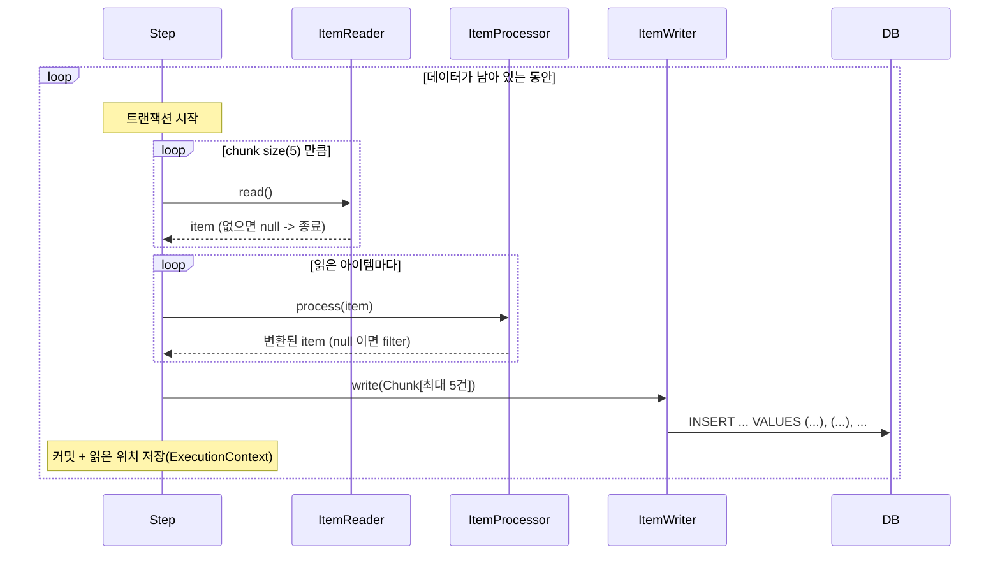

# 05. Chunk 지향 처리

## 학습 목표

- Chunk 지향 처리(Read - Process - Write)의 흐름과 트랜잭션 범위를 이해한다.
- `FlatFileItemReader` 로 CSV 파일을 읽을 수 있다.
- `ItemProcessor` 로 데이터를 정제/필터링할 수 있다.
- jOOQ 로 Chunk 단위 multi-row INSERT 를 하는 `ItemWriter` 를 만들 수 있다.

실습 코드: [`lesson05/`](../src/main/java/com/example/batch/lesson05)

| 파일 | 역할 |
|------|------|
| [`ProductImportJobConfig`](../src/main/java/com/example/batch/lesson05/ProductImportJobConfig.java) | Job / Step / Reader 빈 정의 |
| [`ProductCsvReaders`](../src/main/java/com/example/batch/lesson05/ProductCsvReaders.java) | CSV Reader 생성 (08장에서도 재사용) |
| [`ProductItemProcessor`](../src/main/java/com/example/batch/lesson05/ProductItemProcessor.java) | 정제 + 필터 + 검증 |
| [`ProductJooqItemWriter`](../src/main/java/com/example/batch/lesson05/ProductJooqItemWriter.java) | jOOQ multi-row INSERT |
| [`input/products.csv`](../src/main/resources/input/products.csv) | 입력 파일 (22건) |

---

## 1. Chunk 지향 처리란?

**N건(chunk size)씩 묶어서** 읽기 -> 가공 -> 쓰기를 하고, **묶음마다 커밋**하는 방식입니다.



| 포인트 | 설명 |
|--------|------|
| Reader 는 1건씩 | `read()` 는 아이템 1개를 반환. 더 없으면 `null` -> Step 종료 신호 |
| Processor 는 1건씩 | `null` 을 반환하면 그 아이템은 **버려진다(filter)** |
| Writer 는 묶음으로 | `write(Chunk)` 로 최대 chunk size 만큼 한 번에 받는다 -> **DB 왕복 횟수 감소** |
| 트랜잭션은 Chunk 단위 | 5건 처리 중 예외 -> 그 5건만 롤백. 이미 커밋된 앞 Chunk 는 유지 |
| 메모리 | 한 번에 chunk size 만큼만 메모리에 올린다 |

> **chunk size 는 어떻게 정할까?** 너무 작으면 커밋이 잦아 느리고, 너무 크면 롤백 범위와 메모리 사용이 커집니다.
> 보통 100 ~ 1,000 에서 시작해 측정하면서 조정합니다. 이 강의는 동작을 눈으로 보기 위해 5 로 작게 잡았습니다.

---

## 2. Step 정의 (Spring Batch 6 방식)

```java
@Bean
public Step productImportStep(JobRepository jobRepository,
                              PlatformTransactionManager transactionManager,
                              FlatFileItemReader<ProductCsvRow> productCsvReader,
                              DSLContext dsl) {
    return new StepBuilder("productImportStep", jobRepository)
            .<ProductCsvRow, Product>chunk(CHUNK_SIZE)     // <입력 타입, 출력 타입>chunk(5)
            .transactionManager(transactionManager)
            .reader(productCsvReader)
            .processor(new ProductItemProcessor())
            .writer(new ProductJooqItemWriter(dsl))
            .build();
}
```

> Spring Batch 5 까지는 `.chunk(5, transactionManager)` 로 썼습니다.
> 6.0 에서는 새로운 `ChunkOrientedStep` 을 만드는 `.chunk(5).transactionManager(tm)` 방식이 표준이고, 예전 방식은 deprecated(forRemoval) 입니다.

입력 타입과 출력 타입을 다르게 둔 것에 주목하세요.

```java
public record ProductCsvRow(String code, String name, long price, int stock) {}  // 파일 그대로
public record Product(String code, String name, long price, int stock) {}        // 저장할 형태
```

"외부에서 들어온 데이터"와 "검증/정제를 마친 데이터"를 타입으로 구분하면 Processor 의 역할이 명확해집니다.

---

## 3. ItemReader: FlatFileItemReader

```java
public static FlatFileItemReader<ProductCsvRow> create(String name, Resource resource) {
    return new FlatFileItemReaderBuilder<ProductCsvRow>()
            .name(name)                       // ExecutionContext 저장 키 (재시작 시 위치 복원)
            .resource(resource)
            .encoding("UTF-8")
            .linesToSkip(1)                   // 헤더 건너뛰기
            .delimited()
            .delimiter(",")
            .names("code", "name", "price", "stock")
            .targetType(ProductCsvRow.class)  // record 면 생성자로 바인딩
            .build();
}
```

```csv
code,name,price,stock
p-001,무선 마우스,25000,120
p-002,기계식 키보드,89000,45
...
p-013,사은품 스티커,0,1000
```

입력 파일은 **JobParameter(`inputFile`)** 로 받습니다. 그래서 Reader 를 `@StepScope` 빈으로 만들었습니다.

```java
@Bean
@StepScope
public FlatFileItemReader<ProductCsvRow> productCsvReader(
        ResourceLoader resourceLoader,
        @Value("#{jobParameters['inputFile']}") String inputFile) {   // classpath:..., file:...
    return ProductCsvReaders.create("productCsvReader", resourceLoader.getResource(inputFile));
}
```

Job 에는 incrementer 대신 **`inputFile` 필수 검증**을 넣었습니다.

```java
return new JobBuilder("productImportJob", jobRepository)
        .validator(new DefaultJobParametersValidator(new String[]{"inputFile"}, new String[]{}))
        .listener(jobSummaryListener)
        .start(productImportStep)
        .build();
```

**입력 파일 = JobInstance 의 식별자**가 되도록 설계한 것입니다.

- 같은 파일을 실수로 두 번 적재하려 하면 `JobInstanceAlreadyCompleteException` 으로 막힌다.
- 적재 중 실패하면, 파일을 고친 뒤 같은 파라미터로 다시 실행해 **실패한 지점부터 재시작**할 수 있다. (10장)
- 04장에서 본 것처럼 Spring Batch 6 에서는 incrementer 가 있으면 `inputFile` 파라미터가 무시되므로, 여기서는 incrementer 를 쓰면 안 된다.

> **Reader 를 `@StepScope` 빈으로 등록하는 이유**
> 1. JobParameters 를 주입받기 위해 (Late Binding)
> 2. `FlatFileItemReader` 는 `ItemStream` 이라 `open()` / `update()` / `close()` 가 호출되어야 하는데, 빈으로 등록하면 Step 이 자동으로 등록/호출해 준다.
> 3. Reader 는 읽은 위치라는 **상태**를 가지므로 Step 실행마다 새 인스턴스가 안전하다.

### 다른 Reader 들

| Reader | 용도 |
|--------|------|
| `FlatFileItemReader` | CSV, 고정 길이 텍스트 |
| `JsonItemReader` | JSON 배열 파일 |
| `StaxEventItemReader` | XML |
| `JdbcCursorItemReader` / `JdbcPagingItemReader` | DB (Spring Batch 기본 제공) |
| 직접 구현 | jOOQ, 외부 API 등 (06장에서 jOOQ Reader 를 만든다) |

---

## 4. ItemProcessor: 정제, 필터, 검증

```java
public class ProductItemProcessor implements ItemProcessor<ProductCsvRow, Product> {

    @Override
    public Product process(ProductCsvRow row) {
        if (row.price() < 0 || row.stock() < 0) {
            throw new ValidationException("가격/재고는 음수일 수 없습니다: " + row);  // 08장에서 skip
        }
        if (row.price() == 0) {
            return null;                    // 사은품은 적재하지 않는다 -> filterCount + 1
        }
        return new Product(
                row.code().trim().toUpperCase(Locale.ROOT),   // p-001 -> P-001
                row.name().trim(),
                row.price(),
                row.stock());
    }
}
```

| Processor 의 결과 | 의미 |
|-------------------|------|
| 객체 반환 | Writer 로 전달 |
| `null` 반환 | **필터링**. 정상적인 "제외"이며 `filter_count` 가 증가 |
| 예외 발생 | **오류**. 기본적으로 Step 실패 (08장에서 skip 처리) |

> Processor 는 **새 객체를 만들어 반환**합니다. 입력 객체를 수정하지 않으면(불변) 재시도/스킵 시 같은 아이템을 다시 처리해도 안전합니다.

---

## 5. ItemWriter: jOOQ multi-row INSERT

```java
public class ProductJooqItemWriter implements ItemWriter<Product> {

    private final DSLContext dsl;

    @Override
    public void write(Chunk<? extends Product> chunk) {
        if (chunk.isEmpty()) {
            return;
        }
        var insert = dsl.insertInto(PRODUCT, PRODUCT.CODE, PRODUCT.NAME, PRODUCT.PRICE, PRODUCT.STOCK);
        for (Product product : chunk) {
            insert = insert.values(product.code(), product.name(), product.price(), product.stock());
        }
        insert.execute();
    }
}
```

실행되는 SQL (chunk 1개 = INSERT 1번):

```sql
insert into "product" ("code", "name", "price", "stock")
values (?, ?, ?, ?), (?, ?, ?, ?), (?, ?, ?, ?), (?, ?, ?, ?), (?, ?, ?, ?)
```

- `PRODUCT.PRICE` 는 `Field<Long>` 이라서 `String` 을 넣으면 **컴파일 에러**가 납니다. jOOQ 를 쓰는 가장 큰 이유입니다.
- jOOQ 는 Spring Boot 가 구성한 `DSLContext` 를 통해 **Step 의 Chunk 트랜잭션에 참여**합니다. Writer 에서 예외가 나면 이 INSERT 도 롤백됩니다.
- 실행 SQL 을 보고 싶으면 `application.yml` 에서 `org.jooq.tools.LoggerListener: debug` 로 바꿉니다.

> **multi-row INSERT vs JDBC batch**: 둘 다 DB 왕복을 줄입니다.
> 06장에서는 `dsl.batch(...)` 로 JDBC batch UPDATE 를 사용합니다.

---

## 6. 실습

### 6-1. 실행

```bash
./gradlew bootRun --args='--spring.batch.job.name=productImportJob inputFile=classpath:input/products.csv'
```

```
>>> [productImportJob] 시작 - parameters={JobParameter{name='inputFile', value=classpath:input/products.csv, type=class java.lang.String, identifying=true}}
<<< [productImportJob] 종료 - status=COMPLETED, exitStatus=COMPLETED, elapsed=109ms
    - step=productImportStep status=COMPLETED read=22 filter=2 write=20 skip=0 commit=5 rollback=0
```

숫자를 해석해 봅시다.

| 항목 | 값 | 이유 |
|------|----|------|
| read | 22 | CSV 데이터 22줄 |
| filter | 2 | 가격 0원인 사은품 2건 (`p-013`, `p-019`) |
| write | 20 | 22 - 2 |
| commit | 5 | 22건 / chunk 5 = 5, 5, 5, 5, 2 -> 5번 |

### 6-2. 결과 확인

```sql
SELECT code, name, price, stock FROM product ORDER BY code;
-- P-001 | 무선 마우스 | 25000 | 120   <- 대문자로 변환됨
```

### 6-3. 같은 파일로 다시 실행

같은 명령을 한 번 더 실행하면 `JobInstanceAlreadyCompleteException` 이 납니다. 같은 파일은 한 번만 적재됩니다.

### 6-4. 다른 파일로 실행

```bash
cp src/main/resources/input/products.csv /tmp/my-products.csv
# /tmp/my-products.csv 를 수정한 뒤
./gradlew bootRun --args='--spring.batch.job.name=productImportJob inputFile=file:/tmp/my-products.csv'
```

### 6-5. 실험: chunk size 바꿔 보기

`ProductImportJobConfig.CHUNK_SIZE` 를 1, 10, 100 으로 바꿔 보고 commit 수가 어떻게 바뀌는지 확인해 보세요.
같은 파일로는 다시 실행할 수 없으므로, 식별 파라미터를 하나 더 붙여서 새 JobInstance 로 실행합니다.

```bash
./gradlew bootRun --args='--spring.batch.job.name=productImportJob inputFile=classpath:input/products.csv attempt=2,java.lang.Long'
```

### 6-6. 실험: 실패시키기

6-4 처럼 `/tmp/my-products.csv` 를 만들고 아무 줄이나 가격을 `-1` 로 바꾼 뒤 실행해 보세요.

- Step 이 FAILED 가 되고, **실패한 Chunk 만 롤백**됩니다. 그 앞 Chunk 들은 이미 커밋되어 DB 에 남아 있습니다.
- `BATCH_STEP_EXECUTION` 의 `rollback_count`, `commit_count` 를 확인해 보세요.
- 이런 불량 데이터를 건너뛰는 방법은 08장에서, 고친 파일로 **이어서 처리(재시작)** 하는 방법은 10장에서 배웁니다.

---

## 정리

- Chunk 지향 처리 = **N건 읽기 -> 건별 가공 -> N건 한 번에 쓰기 -> 커밋** 의 반복.
- Processor 에서 `null` 반환은 **필터**, 예외는 **오류**.
- Writer 는 Chunk 를 받으므로 multi-row INSERT / JDBC batch 로 DB 왕복을 줄인다.
- jOOQ 는 Spring 트랜잭션에 참여하므로 Chunk 롤백 시 함께 롤백된다.

## 확인 문제

1. chunk size 가 5 이고 13번째 아이템에서 Writer 예외가 났다. DB 에는 몇 건이 남아 있을까?
2. Processor 에서 입력 객체의 필드를 직접 바꾸면(가변 객체) 어떤 문제가 생길 수 있을까?
3. `attempt=2` 를 붙여 같은 CSV 를 다시 적재하면 UNIQUE 제약(`product.code`) 위반이 날까? (힌트: 매 기동 시 `schema.sql` 이 실행된다)

---

[← 이전: 04. JobParameters 와 메타데이터](04-job-parameters-and-metadata.md) | [목차](../README.md) | [다음: 06. jOOQ 로 DB -> DB 처리 →](06-db-to-db-with-jooq.md)
