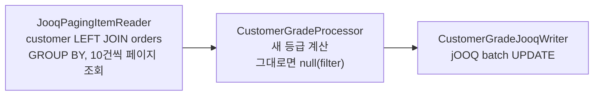

# 06. jOOQ 로 DB -> DB 처리

## 학습 목표

- DB 에서 대량 데이터를 읽는 두 가지 방식(Cursor / Paging)의 차이를 이해한다.
- `AbstractPaginatedDataItemReader` 를 상속해 **jOOQ 페이징 Reader** 를 만들 수 있다.
- Reader 의 **재시작(restart)** 이 어떻게 동작하는지, 직접 만든 Reader 에서 무엇을 조심해야 하는지 안다.
- jOOQ `batch()` 로 JDBC batch UPDATE 를 하는 Writer 를 만들 수 있다.

실습 코드:
[`common/JooqPagingItemReader.java`](../src/main/java/com/example/batch/common/JooqPagingItemReader.java),
[`lesson06/`](../src/main/java/com/example/batch/lesson06)

---

## 1. 만들 Job: 고객 등급 산정

고객별 **누적 결제 금액(PAID 주문 합계)** 으로 등급을 다시 매깁니다.

| 등급 | 누적 결제 금액 |
|------|----------------|
| VIP | 1,000,000 원 이상 |
| GOLD | 500,000 원 이상 |
| SILVER | 200,000 원 이상 |
| BRONZE | 그 외 |



등급 정책은 순수 Java enum 으로 분리했습니다. 배치 프레임워크 없이 단위 테스트할 수 있습니다.

```java
public enum CustomerGrade {
    VIP(1_000_000L), GOLD(500_000L), SILVER(200_000L), BRONZE(0L);

    public static CustomerGrade of(long totalPaidAmount) {
        // 선언 순서가 높은 등급 -> 낮은 등급이므로, 처음 만족하는 등급이 정답이다.
        return Arrays.stream(values())
                .filter(grade -> totalPaidAmount >= grade.minimumAmount)
                .findFirst()
                .orElse(BRONZE);
    }
}
```

---

## 2. DB 를 읽는 두 가지 방식

| | Cursor 방식 | Paging 방식 |
|---|-------------|-------------|
| 동작 | SELECT 1번, 커넥션을 열어 둔 채 1건씩 fetch | `LIMIT/OFFSET` 으로 페이지마다 SELECT |
| 커넥션 | Step 이 끝날 때까지 **계속 점유** | 페이지 조회 때만 사용 |
| 장점 | 빠르고 정렬이 일관됨 | 커넥션/타임아웃 부담이 적음, 멀티 스레드에 유리 |
| 단점 | 긴 Step 에서 커넥션 타임아웃, 멀티 스레드 불가 | 처리 중 데이터가 바뀌면 누락/중복 위험, 뒤 페이지일수록 OFFSET 비용 증가 |
| 기본 제공 | `JdbcCursorItemReader` | `JdbcPagingItemReader` |

Spring Batch 는 jOOQ 전용 Reader 를 제공하지 않으므로, 이 강의에서는 **Paging 방식 Reader 를 jOOQ 로 직접 만듭니다.**

---

## 3. JooqPagingItemReader 만들기

```java
public class JooqPagingItemReader<T> extends AbstractPaginatedDataItemReader<T> {

    @FunctionalInterface
    public interface PageQuery<T> {
        List<T> fetch(int offset, int limit);
    }

    private final PageQuery<T> pageQuery;

    public JooqPagingItemReader(String name, int pageSize, PageQuery<T> pageQuery) {
        this.pageQuery = pageQuery;
        setName(name);          // ExecutionContext 키 접두어
        setPageSize(pageSize);
    }

    @Override
    protected Iterator<T> doPageRead() {
        int offset = page * pageSize;
        return pageQuery.fetch(offset, pageSize).iterator();
    }
}
```

`AbstractPaginatedDataItemReader` 가 해 주는 일:

- `read()` 호출 시 현재 페이지가 소진되면 `doPageRead()` 로 다음 페이지를 가져온다.
- 페이지가 비어 있으면 `null` 을 반환해 Step 을 끝낸다.
- 읽은 건수(`이름.read.count`)를 **ExecutionContext 에 저장**한다. -> 재시작 시 그 위치부터 다시 읽는다.

### Reader 를 만들 때 쓰는 쿼리

```java
@Bean
@StepScope
public JooqPagingItemReader<CustomerSales> customerSalesReader(DSLContext dsl) {
    var totalPaid = coalesce(sum(ORDERS.AMOUNT), val(BigDecimal.ZERO));

    return new JooqPagingItemReader<>("customerSalesReader", CHUNK_SIZE, (offset, limit) ->
            dsl.select(CUSTOMER.ID, CUSTOMER.NAME, CUSTOMER.GRADE, totalPaid)
                    .from(CUSTOMER)
                    .leftJoin(ORDERS)
                    .on(ORDERS.CUSTOMER_ID.eq(CUSTOMER.ID).and(ORDERS.STATUS.eq(PAID)))
                    .groupBy(CUSTOMER.ID, CUSTOMER.NAME, CUSTOMER.GRADE)
                    .orderBy(CUSTOMER.ID)          // 페이징에는 반드시 고유한 정렬 기준!
                    .offset(offset)
                    .limit(limit)
                    .fetch(row -> new CustomerSales(
                            row.value1(), row.value2(), row.value3(), row.value4().longValue())));
}
```

생성되는 SQL:

```sql
select "customer"."id", "customer"."name", "customer"."grade", coalesce(sum("orders"."amount"), ?)
from "customer"
left outer join "orders" on ("orders"."customer_id" = "customer"."id" and "orders"."status" = ?)
group by "customer"."id", "customer"."name", "customer"."grade"
order by "customer"."id"
offset ? rows fetch next ? rows only
```

- `LEFT JOIN` 이라 주문이 없는 고객도 0원으로 읽힌다.
- `sum()` 은 PostgreSQL 에서 `numeric` 이라 jOOQ 에서 `BigDecimal` 로 받는다.
- `.fetch(row -> new CustomerSales(...))` 로 바로 불변 record 로 매핑한다.

### 페이징 Reader 의 함정 (꼭 기억하기)

1. **정렬 기준은 반드시 고유해야 한다.** `ORDER BY name` 처럼 중복 가능한 값이면 페이지 경계에서 순서가 바뀌어 누락/중복이 생긴다.
2. **읽는 조건(WHERE)에 해당하는 데이터를 같은 Step 에서 바꾸면 안 된다.**
   예를 들어 `WHERE grade = 'BRONZE'` 로 읽으면서 grade 를 바꾸면, 다음 페이지 OFFSET 이 밀려서 데이터를 건너뛴다.
   이 예제는 WHERE 없이 `customer.id` 순서로 전부 읽기 때문에 안전하다.
3. 데이터가 아주 많으면 OFFSET 이 커질수록 느려진다. 이때는 `WHERE id > 마지막ID ORDER BY id LIMIT n` 형태의 **No-Offset(Keyset) 페이징**을 고려한다. (10장 연습 과제)

---

## 4. 재시작 테스트에서 발견한 버그

직접 만든 Reader 는 **재시작 시나리오를 꼭 테스트**해야 합니다.
[`JooqPagingItemReaderTest`](../src/test/java/com/example/batch/common/JooqPagingItemReaderTest.java) 의 재시작 테스트를 처음 돌렸을 때 결과는 이랬습니다.

```
데이터: [1, 2, 3, 4, 5, 6, 7], pageSize = 3, 4건 읽고 중단 -> 재시작
기대: [5, 6, 7]
실제: [5, 6, 4, 5, 6, 7]     <- 4, 5, 6 중복!
```

Spring Batch 6.0.5 의 `AbstractPaginatedDataItemReader.jumpToItem()` 기본 구현은 재시작 위치로 이동한 뒤 **page 를 증가시키지 않아서** 같은 페이지를 한 번 더 읽습니다.
그래서 `jumpToItem` 을 직접 구현했습니다.

```java
@Override
protected void jumpToItem(int itemIndex) {
    page = itemIndex / pageSize;          // 재시작할 페이지
    int skipInPage = itemIndex % pageSize; // 그 페이지에서 이미 처리한 건수

    Iterator<T> currentPage = doPageRead();
    page++;                                // 다음 doPageRead() 는 그 다음 페이지
    for (int i = 0; i < skipInPage && currentPage.hasNext(); i++) {
        currentPage.next();
    }
    results = currentPage;
}
```

> 교훈: **Reader 의 재시작은 "중복 처리"나 "누락"과 직결**됩니다. 프레임워크의 추상 클래스를 상속했더라도 재시작 테스트를 반드시 작성하세요.

---

## 5. Processor: 바뀐 고객만 넘기기

```java
public class CustomerGradeProcessor implements ItemProcessor<CustomerSales, GradeChange> {

    @Override
    public GradeChange process(CustomerSales item) {
        CustomerGrade newGrade = CustomerGrade.of(item.totalPaidAmount());
        if (newGrade.name().equals(item.currentGrade())) {
            return null;                 // 등급 그대로 -> UPDATE 할 필요 없음
        }
        return new GradeChange(item.customerId(), item.currentGrade(), newGrade);
    }
}
```

필요 없는 UPDATE 를 줄이면 DB 부하와 락이 줄어듭니다. 또 **두 번 실행해도 결과가 같습니다(멱등성).** 두 번째 실행에서는 모두 filter 됩니다.

---

## 6. Writer: jOOQ batch UPDATE

```java
@Override
public void write(Chunk<? extends GradeChange> chunk) {
    var updates = chunk.getItems().stream()
            .map(change -> dsl.update(CUSTOMER)
                    .set(CUSTOMER.GRADE, change.afterGrade().name())
                    .where(CUSTOMER.ID.eq(change.customerId())))
            .toList();

    dsl.batch(updates).execute();      // JDBC batch 로 한 번에 전송
}
```

`dsl.batch(...)` 는 여러 쿼리를 JDBC `addBatch()` / `executeBatch()` 로 묶어 **DB 왕복 1번**에 보냅니다.

---

## 7. 실습

### 7-1. 실행 전 등급 확인

```sql
SELECT grade, count(*) FROM customer GROUP BY grade;
--  BRONZE | 18
--  GOLD   | 1     (19번 류지안)
--  VIP    | 1     (20번 홍유나)
```

### 7-2. 실행

```bash
./gradlew bootRun --args='--spring.batch.job.name=customerGradeJob'
```

```
고객 2 등급 변경: BRONZE -> VIP
고객 3 등급 변경: BRONZE -> VIP
...
고객 9 등급 변경: BRONZE -> GOLD
...
고객 20 등급 변경: VIP -> GOLD
<<< [customerGradeJob] 종료 - status=COMPLETED, exitStatus=COMPLETED
    - step=customerGradeStep status=COMPLETED read=20 filter=3 write=17 skip=0 commit=2 rollback=0
```

### 7-3. 검증 쿼리

등급이 실제 누적 금액과 맞는지 SQL 로 직접 검증해 봅니다.

```sql
SELECT c.id, c.name, c.grade, coalesce(sum(o.amount), 0) AS total_paid
FROM customer c
LEFT JOIN orders o ON o.customer_id = c.id AND o.status = 'PAID'
GROUP BY c.id
ORDER BY c.id;
```

> 다음에 애플리케이션을 띄우면 `data.sql` 이 다시 실행되어 등급이 초기값으로 돌아갑니다.

### 7-4. 실험

1. `CHUNK_SIZE` 를 3 으로 바꾸면 commit 수는? (20건 / 3 = 7)
2. Reader 쿼리의 `.orderBy(CUSTOMER.ID)` 를 지우고 테스트(`./gradlew test --tests '*CustomerGrade*'`)를 돌려 보자. 항상 통과할까?

---

## 정리

- DB Reader 는 Cursor(커넥션 유지) / Paging(페이지마다 조회) 두 방식이 있다.
- `AbstractPaginatedDataItemReader` + jOOQ 로 **타입 안전한 페이징 Reader** 를 쉽게 만들 수 있다.
- 페이징 Reader 는 **고유한 정렬**, **읽는 조건을 바꾸지 않기**를 지켜야 한다.
- 직접 만든 Reader 는 **재시작 테스트**를 반드시 하자. (실제로 버그를 잡았다)
- Writer 는 `dsl.batch()` 로 JDBC batch 를 활용한다.

## 확인 문제

1. 등급이 BRONZE 인 고객만 읽어서 등급을 올리는 Job 을 Paging Reader 로 만들면 어떤 문제가 생길까?
2. Processor 에서 null 을 반환하는 것이 성능 말고 어떤 장점이 있을까?
3. `CustomerGrade` 를 enum 으로 분리해서 얻는 테스트 상의 이점은?

---

[← 이전: 05. Chunk 지향 처리](05-chunk-oriented-processing.md) | [목차](../README.md) | [다음: 07. 여러 Step 과 Flow →](07-multi-step-and-flow.md)
