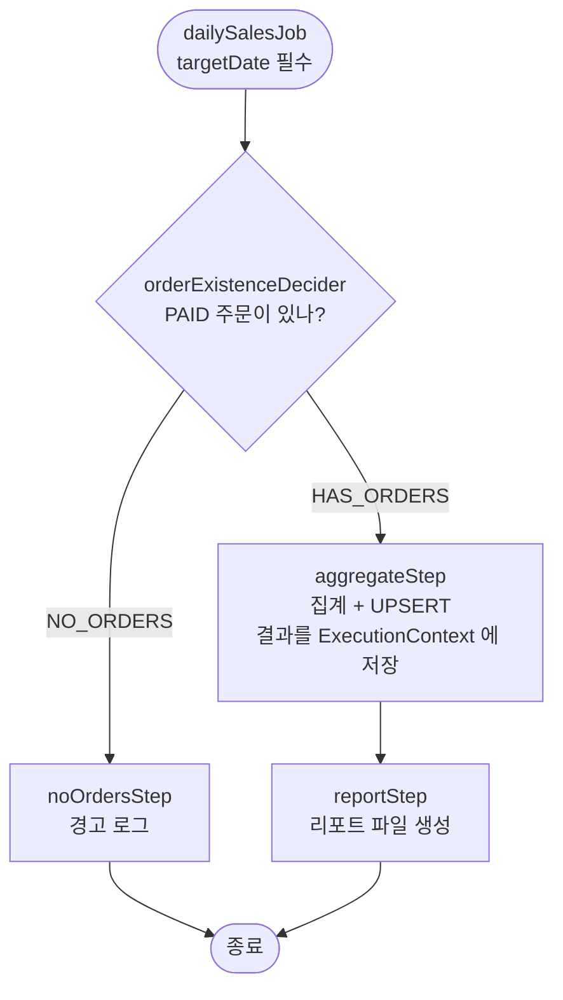
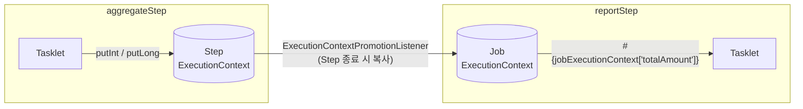

# 07. 여러 Step 과 Flow

## 학습 목표

- `JobExecutionDecider` 로 조건에 따라 다른 Step 을 실행할 수 있다.
- `ExecutionContext` 로 Step 간에 데이터를 넘길 수 있다. (`ExecutionContextPromotionListener`)
- 같은 날짜로 여러 번 실행해도 결과가 같은 **멱등(idempotent)** 배치를 만들 수 있다. (jOOQ UPSERT)

실습 코드: [`lesson07/`](../src/main/java/com/example/batch/lesson07)

| 파일 | 역할 |
|------|------|
| [`DailySalesJobConfig`](../src/main/java/com/example/batch/lesson07/DailySalesJobConfig.java) | Job 흐름 정의 |
| [`OrderExistenceDecider`](../src/main/java/com/example/batch/lesson07/OrderExistenceDecider.java) | 주문 유무로 분기 |
| [`DailySalesAggregateTasklet`](../src/main/java/com/example/batch/lesson07/DailySalesAggregateTasklet.java) | 집계 + UPSERT + ExecutionContext 저장 |
| [`DailySalesReportTasklet`](../src/main/java/com/example/batch/lesson07/DailySalesReportTasklet.java) | ExecutionContext 값으로 리포트 파일 생성 |
| [`DailySalesQueries`](../src/main/java/com/example/batch/lesson07/DailySalesQueries.java) | 재사용하는 jOOQ 조건식 |

---

## 1. 만들 Job: 일별 매출 집계



```java
@Bean
public Job dailySalesJob(JobRepository jobRepository,
                         OrderExistenceDecider orderExistenceDecider,
                         Step aggregateStep, Step reportStep, Step noOrdersStep,
                         JobSummaryListener jobSummaryListener) {
    return new JobBuilder("dailySalesJob", jobRepository)
            .validator(new DefaultJobParametersValidator(new String[]{"targetDate"}, new String[]{}))
            .listener(jobSummaryListener)
            .start(orderExistenceDecider)
                .on("NO_ORDERS").to(noOrdersStep)
            .from(orderExistenceDecider)
                .on("HAS_ORDERS").to(aggregateStep).next(reportStep)
            .end()
            .build();
}
```

| 메서드 | 의미 |
|--------|------|
| `start(decider)` | 흐름의 시작점 (Step 또는 Decider) |
| `.on("패턴")` | 앞 단계의 **결과(ExitStatus / FlowExecutionStatus)** 가 패턴과 일치하면. `*`, `?` 와일드카드 가능 |
| `.to(step)` | 다음에 실행할 Step |
| `.from(x)` | x 에서 시작하는 다른 분기를 추가로 정의 |
| `.end()` | Flow 정의 끝 (FlowBuilder -> JobBuilder 로 복귀) |

> 순차 실행만 하는 `start().next()` 와 달리, `on()` 을 쓰면 **Step 이 실패해도 Job 을 계속 진행**하게 만들 수도 있습니다.
> 예: `.on("FAILED").to(alertStep)` -> 실패 시 알림 Step 실행

---

## 2. JobExecutionDecider: 조건 분기

```java
@Component
public class OrderExistenceDecider implements JobExecutionDecider {

    public static final FlowExecutionStatus HAS_ORDERS = new FlowExecutionStatus("HAS_ORDERS");
    public static final FlowExecutionStatus NO_ORDERS = new FlowExecutionStatus("NO_ORDERS");

    private final DSLContext dsl;

    @Override
    public FlowExecutionStatus decide(JobExecution jobExecution, StepExecution stepExecution) {
        LocalDate targetDate = jobExecution.getJobParameters().getLocalDate("targetDate");

        boolean exists = dsl.fetchExists(ORDERS, DailySalesQueries.paidOrdersOn(targetDate));
        return exists ? HAS_ORDERS : NO_ORDERS;
    }
}
```

- `dsl.fetchExists(...)` 는 `SELECT EXISTS (SELECT 1 FROM orders WHERE ...)` 를 실행합니다. 건수가 필요 없으면 `count(*)` 보다 효율적입니다.
- Decider 는 Step 이 아니므로 **BATCH_STEP_EXECUTION 에 기록되지 않습니다.** 판단만 합니다.

### Decider 대신 Step 의 ExitStatus 로 분기할 수도 있다

```java
// Tasklet 안에서
contribution.setExitStatus(new ExitStatus("NO_ORDERS"));
// Job 정의
.start(checkStep).on("NO_ORDERS").to(noOrdersStep)
```

"판단" 자체가 하나의 작업이면 Step, 단순 조건 확인이면 Decider 가 깔끔합니다.

### jOOQ 조건식 재사용

```java
final class DailySalesQueries {
    static Condition paidOrdersOn(LocalDate targetDate) {
        return ORDERS.STATUS.eq(PAID)
                .and(ORDERS.ORDERED_AT.ge(targetDate.atStartOfDay()))
                .and(ORDERS.ORDERED_AT.lt(targetDate.plusDays(1).atStartOfDay()));
    }
}
```

jOOQ 의 `Condition` 은 평범한 Java 객체라서, 문자열 SQL 처럼 복사-붙여넣기 하지 않고 **메서드로 재사용**할 수 있습니다. Decider 와 집계 Tasklet 이 같은 조건을 씁니다.

---

## 3. 멱등한 집계: jOOQ UPSERT

```java
var summary = dsl.select(count(), coalesce(sum(ORDERS.AMOUNT), BigDecimal.ZERO))
        .from(ORDERS)
        .where(DailySalesQueries.paidOrdersOn(targetDate))
        .fetchSingle();

int orderCount = summary.value1();
long totalAmount = summary.value2().longValue();

dsl.insertInto(DAILY_SALES_SUMMARY)
        .set(DAILY_SALES_SUMMARY.SALES_DATE, targetDate)
        .set(DAILY_SALES_SUMMARY.ORDER_COUNT, orderCount)
        .set(DAILY_SALES_SUMMARY.TOTAL_AMOUNT, totalAmount)
        .onConflict(DAILY_SALES_SUMMARY.SALES_DATE)     // PK 충돌 시
        .doUpdate()                                     // UPDATE 로 전환
        .set(DAILY_SALES_SUMMARY.ORDER_COUNT, orderCount)
        .set(DAILY_SALES_SUMMARY.TOTAL_AMOUNT, totalAmount)
        .set(DAILY_SALES_SUMMARY.CREATED_AT, currentLocalDateTime())
        .execute();
```

```sql
insert into daily_sales_summary (sales_date, order_count, total_amount) values (?, ?, ?)
on conflict (sales_date) do update set order_count = ?, total_amount = ?, created_at = current_timestamp
```

**왜 멱등성이 중요한가?**
배치는 실패 후 재시작, 운영자의 수동 재실행 등으로 **같은 데이터에 여러 번 실행되는 일이 흔합니다.**
`INSERT` 만 하면 두 번째 실행에서 PK 충돌로 실패하거나, PK 가 없으면 데이터가 두 배가 됩니다.
UPSERT 로 만들면 몇 번을 실행해도 결과가 같습니다.

---

## 4. ExecutionContext 로 Step 간 데이터 전달



| ExecutionContext | 범위 | 저장 위치 |
|------------------|------|-----------|
| Step ExecutionContext | 그 Step 안에서만 | `BATCH_STEP_EXECUTION_CONTEXT` |
| Job ExecutionContext | Job 의 모든 Step 이 공유 | `BATCH_JOB_EXECUTION_CONTEXT` |

### (1) Step ExecutionContext 에 저장

```java
ExecutionContext stepContext = contribution.getStepExecution().getExecutionContext();
stepContext.putInt(ORDER_COUNT_KEY, orderCount);
stepContext.putLong(TOTAL_AMOUNT_KEY, totalAmount);
```

### (2) Job ExecutionContext 로 승격

```java
@Bean
public Step aggregateStep(...) {
    return new StepBuilder("aggregateStep", jobRepository)
            .tasklet(dailySalesAggregateTasklet, transactionManager)
            .listener(promotionListener())
            .build();
}

private ExecutionContextPromotionListener promotionListener() {
    var listener = new ExecutionContextPromotionListener();
    listener.setKeys(new String[]{"orderCount", "totalAmount"});
    return listener;
}
```

> Tasklet 에서 바로 `getJobExecution().getExecutionContext()` 에 넣을 수도 있지만,
> Step 에 넣고 **필요한 키만 승격**하면 "어떤 Step 이 어떤 값을 공유하는지" 가 설정에 드러나서 관리하기 쉽습니다.

### (3) 다음 Step 에서 주입받기

```java
@Component
@StepScope
public class DailySalesReportTasklet implements Tasklet {

    public DailySalesReportTasklet(@Value("#{jobParameters['targetDate']}") LocalDate targetDate,
                                   @Value("#{jobExecutionContext['orderCount']}") int orderCount,
                                   @Value("#{jobExecutionContext['totalAmount']}") long totalAmount,
                                   @Value("${batch.report-dir}") Path reportDir) { ... }
}
```

> **ExecutionContext 에는 작은 값만 넣으세요.** DB 에 직렬화되어 저장되므로 큰 리스트 등을 넣으면 성능이 떨어지고 컬럼 크기 제한에 걸립니다.
> 대량 데이터는 테이블이나 파일로 넘깁니다.

---

## 5. 실습

### 5-1. 주문이 있는 날

```bash
./gradlew bootRun --args='--spring.batch.job.name=dailySalesJob targetDate=2026-10-01,java.time.LocalDate'
```

```
[2026-10-01] 집계 완료 - 주문 38건, 매출 3102000원
리포트 생성: .../build/reports/batch/daily-sales-2026-10-01.txt
<<< [dailySalesJob] 종료 - status=COMPLETED, exitStatus=COMPLETED
    - step=aggregateStep status=COMPLETED ...
    - step=reportStep status=COMPLETED ...
```

```bash
cat build/reports/batch/daily-sales-2026-10-01.txt
```

```
===== 일별 매출 리포트 =====
날짜     : 2026-10-01
주문 건수 : 38건
매출 합계 : 3,102,000원
```

### 5-2. 주문이 없는 날 (2026-10-08)

```bash
./gradlew bootRun --args='--spring.batch.job.name=dailySalesJob targetDate=2026-10-08,java.time.LocalDate'
```

```
집계할 주문이 없습니다. parameters={...targetDate, value=2026-10-08...}
<<< [dailySalesJob] 종료 - status=COMPLETED, exitStatus=COMPLETED
    - step=noOrdersStep status=COMPLETED ...
```

`aggregateStep`, `reportStep` 은 실행되지 않았습니다. BATCH_STEP_EXECUTION 에서도 확인해 보세요.

### 5-3. 일주일치 돌려 보기

```bash
for d in 01 02 03 04 05 06 07; do
  ./gradlew bootRun -q --args="--spring.batch.job.name=dailySalesJob targetDate=2026-10-$d,java.time.LocalDate"
done
```

> 단, 매 기동마다 `schema.sql` 이 실행되어 `daily_sales_summary` 가 비워지므로 마지막 날짜 결과만 남습니다.
> 리포트 파일(`build/reports/batch`)은 7개가 모두 남습니다.

### 5-4. 실험: Job ExecutionContext 확인

```sql
SELECT e.job_execution_id, c.short_context
FROM batch_job_execution_context c
JOIN batch_job_execution e USING (job_execution_id)
ORDER BY 1 DESC LIMIT 3;
```

값은 직렬화(Base64)되어 저장되므로 사람이 바로 읽기는 어렵습니다. 대신 09장의 테스트에서 `execution.getExecutionContext().getLong("totalAmount")` 로 값을 검증합니다.

---

## 정리

- `on().to().from().end()` 로 조건 분기 흐름을 만든다. 판단 로직은 `JobExecutionDecider` 로 분리하면 깔끔하다.
- Step 간 데이터는 **ExecutionContext** 로 넘기고, `ExecutionContextPromotionListener` 로 필요한 키만 Job 범위로 승격한다.
- 배치는 여러 번 실행될 수 있으므로 **UPSERT 등으로 멱등하게** 만든다.

## 확인 문제

1. `aggregateStep` 이 실패했을 때 알림 Step 을 실행하고 Job 은 FAILED 로 끝나게 하려면 Flow 를 어떻게 바꿔야 할까? (힌트: `.on("FAILED").to(alertStep)` 다음에 `.fail()`)
2. `ExecutionContextPromotionListener` 를 빼면 `reportStep` 에서 어떤 일이 생길까?
3. 같은 날짜로 `dailySalesJob` 을 두 번 실행할 수 없는 이유와, 그래도 UPSERT 가 필요한 이유는?

---

[← 이전: 06. jOOQ 로 DB -> DB 처리](06-db-to-db-with-jooq.md) | [목차](../README.md) | [다음: 08. 내결함성: Skip / Retry →](08-fault-tolerance.md)
