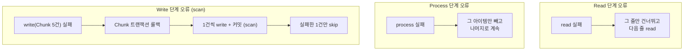

# 08. 내결함성: Skip / Retry

## 학습 목표

- `faultTolerant()` 로 Skip 과 Retry 를 설정할 수 있다.
- Read / Process / Write 단계별로 Skip 이 어떻게 다르게 동작하는지 이해한다. (특히 Write 의 **scan**)
- `SkipListener` 로 Skip 된 데이터를 기록할 때의 **트랜잭션 함정**을 알고 피할 수 있다.

실습 코드:
[`lesson08/FaultTolerantImportJobConfig.java`](../src/main/java/com/example/batch/lesson08/FaultTolerantImportJobConfig.java),
[`lesson08/ProductImportSkipListener.java`](../src/main/java/com/example/batch/lesson08/ProductImportSkipListener.java),
[`input/products-with-errors.csv`](../src/main/resources/input/products-with-errors.csv)

---

## 1. 문제 상황

협력사가 보낸 상품 파일에 잘못된 데이터가 섞여 있습니다.

```csv
code,name,price,stock
e-001,정상 상품 1,10000,10
e-002,정상 상품 2,20000,20
e-003,가격이 숫자가 아님,abc,30            <- (1) 파싱 실패   -> READ 단계 오류
e-004,정상 상품 4,40000,40
e-005,음수 가격,-5000,50                   <- (2) 검증 실패   -> PROCESS 단계 오류
e-006,정상 상품 6,60000,60
e-007,정상 상품 7,70000,70
e-001,중복 코드 (e-001 과 같음),80000,80    <- (3) UNIQUE 위반 -> WRITE 단계 오류
e-009,정상 상품 9,90000,90
e-010,컬럼 개수 부족,100000                <- (4) 파싱 실패   -> READ 단계 오류
e-011,정상 상품 11,110000,110
e-012,음수 재고,120000,-1                  <- (5) 검증 실패   -> PROCESS 단계 오류
e-013,정상 상품 13,130000,130
```

05장의 `productImportJob` 이라면 첫 번째 오류에서 Step 이 FAILED 로 멈춥니다.
하지만 업무적으로는 **"잘못된 몇 건은 따로 기록해 두고, 정상 데이터는 적재"** 하길 원합니다.

---

## 2. Skip / Retry 설정

```java
@Bean
public Step faultTolerantImportStep(...) {
    return new StepBuilder("faultTolerantImportStep", jobRepository)
            .<ProductCsvRow, Product>chunk(CHUNK_SIZE)
            .transactionManager(transactionManager)
            .reader(faultTolerantCsvReader)
            .processor(new ProductItemProcessor())        // 05장 것을 그대로 재사용
            .writer(new ProductJooqItemWriter(dsl))       // 05장 것을 그대로 재사용
            .faultTolerant()
                .skip(FlatFileParseException.class,        // 파일 파싱 실패
                      ValidationException.class,           // Processor 검증 실패
                      DuplicateKeyException.class)         // DB UNIQUE 위반
                .skipLimit(SKIP_LIMIT)                     // 10건 넘게 skip 되면 Step 실패
                .retry(TransientDataAccessException.class) // 일시적인 DB 오류는
                .retryLimit(RETRY_LIMIT)                   // 3번까지 재시도
                .skipListener(new ProductImportSkipListener(dsl, transactionManager))
            .build();
}
```

Reader / Processor / Writer 코드는 **하나도 바꾸지 않았습니다.** 오류 처리 정책은 Step 설정으로 분리됩니다.

| 설정 | 의미 |
|------|------|
| `skip(예외...)` | 이 예외가 나면 해당 아이템을 건너뛰고 계속 진행 |
| `skipLimit(n)` | 전체 skip 건수가 n 을 넘으면 Step 실패 (`SkipLimitExceededException`). **불량이 너무 많으면 멈추는 안전장치** |
| `retry(예외...)` | 이 예외가 나면 같은 처리를 다시 시도 |
| `retryLimit(n)` | 최대 시도 횟수. 넘으면 skip 대상이면 skip, 아니면 실패 |

### 어떤 예외를 Skip / Retry 해야 할까?

| 종류 | 예 | 정책 |
|------|----|------|
| **데이터 자체의 문제** (다시 해도 실패) | 파싱 실패, 검증 실패, 제약 조건 위반 | **Skip** + 기록 |
| **일시적인 문제** (다시 하면 성공할 수 있음) | 데드락, 락 타임아웃, 네트워크 순단 | **Retry** |
| **시스템 문제** | DB 다운, 디스크 꽉 참, 버그(NPE) | Skip/Retry 하지 말고 **실패시켜서 사람이 보게** |

> `Exception.class` 를 통째로 skip 하면 버그까지 조용히 묻힙니다. **skip 할 예외는 구체적으로** 지정하세요.

> Spring Batch 6 의 Retry 는 spring-retry 라이브러리가 아니라 Spring Framework 7 의 `org.springframework.core.retry` 를 사용합니다.
> 그래서 skip 대상 예외가 Writer 에서 나면 로그에 `RetryException: Retry policy for operation 'Retryable write operation' exhausted` 가 함께 찍히는데,
> "재시도 대상이 아니므로 즉시 포기하고 skip 처리로 넘어간다"는 뜻이니 놀라지 않아도 됩니다.

---

## 3. 단계별 Skip 동작



**Write 단계가 특별한 이유**: Writer 는 Chunk 단위(여러 건)로 실행되므로, 예외가 났을 때 **어느 아이템 때문인지 모릅니다.**
그래서 Spring Batch 는 Chunk 를 롤백한 뒤 **아이템을 1건씩 다시 써 보면서(scan)** 범인을 찾아 그 건만 skip 합니다.

실행 결과의 `rollback=2` 는 이 과정에서 생긴 롤백입니다. (Chunk 전체 롤백 + 범인 1건 롤백)

> scan 은 1건씩 커밋하므로 느립니다. Write 단계 오류가 많이 예상되면 Processor 에서 미리 검증해 걸러내는 편이 낫습니다.

---

## 4. SkipListener 와 트랜잭션 함정

Skip 된 데이터는 `product_import_error` 테이블에 남깁니다.

```java
public class ProductImportSkipListener implements SkipListener<ProductCsvRow, Product> {

    @Override
    public void onSkipInRead(Throwable t) {
        String item = (t instanceof FlatFileParseException e)
                ? "line " + e.getLineNumber() + ": " + e.getInput()   // 원본 줄 번호와 내용
                : null;
        record("READ", item, t);
    }

    @Override
    public void onSkipInProcess(ProductCsvRow item, Throwable t) { record("PROCESS", String.valueOf(item), t); }

    @Override
    public void onSkipInWrite(Product item, Throwable t) { record("WRITE", String.valueOf(item), t); }
}
```

### 처음 만든 버전: 같은 트랜잭션에 INSERT

처음에는 `record()` 에서 그냥 `dsl.insertInto(PRODUCT_IMPORT_ERROR)...execute()` 를 했습니다. 실행 결과:

```
[SKIP:WRITE] item=Product[code=E-001, ...] reason=DuplicateKeyException ...
org.jooq.exception.DataAccessException: SQL [insert into "product_import_error" ...];
  ERROR: current transaction is aborted, commands ignored until end of transaction block
```

```
 phase   | item
---------+--------------------------------------
 READ    | line 4: e-003,가격이 숫자가 아님,abc,30
 PROCESS | ProductCsvRow[code=e-005, ...]
 PROCESS | ProductCsvRow[code=e-012, ...]
(3 rows)       <- 5건이어야 하는데 3건뿐!
```

**두 가지 문제**가 있었습니다.

1. **WRITE skip 기록 실패**: SkipListener 는 Chunk 트랜잭션 안에서 호출될 수 있습니다. PostgreSQL 은 트랜잭션 안에서 SQL 오류가 한 번 나면 그 트랜잭션을 **abort 상태**로 만들고 이후 모든 SQL 을 거부합니다.
2. **READ skip(e-010) 기록 유실**: e-010 은 중복 코드(e-001)와 같은 Chunk 에 있었습니다. 기록은 성공했지만 **그 Chunk 가 롤백되면서 기록도 함께 롤백**되었습니다.

### 해결: REQUIRES_NEW 로 별도 트랜잭션

```java
public ProductImportSkipListener(DSLContext dsl, PlatformTransactionManager transactionManager) {
    this.dsl = dsl;
    this.requiresNewTx = new TransactionTemplate(transactionManager);
    this.requiresNewTx.setPropagationBehavior(TransactionDefinition.PROPAGATION_REQUIRES_NEW);
}

private void record(String phase, String item, Throwable t) {
    requiresNewTx.executeWithoutResult(status -> dsl.insertInto(PRODUCT_IMPORT_ERROR)
            .set(PRODUCT_IMPORT_ERROR.PHASE, phase)
            .set(PRODUCT_IMPORT_ERROR.ITEM, item)
            .set(PRODUCT_IMPORT_ERROR.REASON, reason)
            .execute());
}
```

`REQUIRES_NEW` 는 현재 트랜잭션을 잠시 멈추고 **새 커넥션으로 새 트랜잭션**을 열어 커밋합니다.
Chunk 트랜잭션이 abort 되거나 롤백되어도 에러 기록은 남습니다.

> **교훈**: 리스너에서 DB 에 쓸 때는 "이 코드가 어떤 트랜잭션 안에서 실행되는가?" 를 반드시 생각하세요.
> 에러/감사 로그처럼 **본 작업이 롤백되어도 남아야 하는 기록**은 별도 트랜잭션으로 분리합니다.
> 단, REQUIRES_NEW 는 커넥션을 하나 더 쓰므로 커넥션 풀 크기도 고려해야 합니다.

---

## 5. 실습

### 5-1. 실행

```bash
./gradlew bootRun --args='--spring.batch.job.name=faultTolerantImportJob inputFile=classpath:input/products-with-errors.csv'
```

```
[SKIP:READ] item=line 4: e-003,가격이 숫자가 아님,abc,30 reason=FlatFileParseException: For input string: "abc"
[SKIP:PROCESS] item=ProductCsvRow[code=e-005, ...] reason=ValidationException: 가격/재고는 음수일 수 없습니다 ...
[SKIP:READ] item=line 11: e-010,컬럼 개수 부족,100000 reason=FlatFileParseException: Incorrect number of tokens found in record: expected 4 actual 3
[SKIP:WRITE] item=Product[code=E-001, ...] reason=DuplicateKeyException: ERROR: duplicate key value violates unique constraint "product_code_key"
[SKIP:PROCESS] item=ProductCsvRow[code=e-012, ...] reason=ValidationException: 가격/재고는 음수일 수 없습니다 ...
<<< [faultTolerantImportJob] 종료 - status=COMPLETED, exitStatus=COMPLETED
    - step=faultTolerantImportStep status=COMPLETED read=11 filter=0 write=8 skip=5 commit=3 rollback=2
```

| 항목 | 값 | 이유 |
|------|----|------|
| read | 11 | 13줄 중 파싱 실패 2줄은 read 로 세지 않음 |
| skip | 5 | READ 2 + PROCESS 2 + WRITE 1 |
| write | 8 | 정상 데이터 8건 |
| rollback | 2 | Write 오류로 인한 Chunk 롤백 + scan 중 범인 1건 롤백 |

### 5-2. 결과 확인

```sql
SELECT phase, item, reason FROM product_import_error ORDER BY id;
SELECT code, name FROM product ORDER BY code;   -- E-001 ~ E-013 중 정상 8건

SELECT step_name, read_count, write_count, read_skip_count, process_skip_count,
       write_skip_count, commit_count, rollback_count
FROM batch_step_execution WHERE step_name = 'faultTolerantImportStep'
ORDER BY step_execution_id DESC LIMIT 1;
```

### 5-3. 실험: skipLimit 넘기기

`SKIP_LIMIT` 를 3 으로 바꾸고 실행해 보세요. (이미 성공한 파일이므로 `attempt=2,java.lang.Long` 같은 식별 파라미터를 추가) 4번째 skip 에서 Step 이 FAILED 가 됩니다.
이미 커밋된 Chunk 의 데이터는 남아 있다는 점도 확인하세요. (10장에서 재시작으로 이어서 처리합니다)

### 5-4. 실험: REQUIRES_NEW 빼 보기

`record()` 에서 `requiresNewTx.executeWithoutResult(...)` 를 지우고 INSERT 만 남긴 뒤 실행해서, 위 4장에서 설명한 문제를 직접 재현해 보세요.
테스트 [`FaultTolerantImportJobTest`](../src/test/java/com/example/batch/lesson08/FaultTolerantImportJobTest.java) 도 실패하는 것을 확인할 수 있습니다.

---

## 정리

- `faultTolerant()` + `skip/skipLimit/retry/retryLimit` 로 **비즈니스 코드 변경 없이** 오류 정책을 설정한다.
- 데이터 문제는 Skip, 일시적 문제는 Retry, 시스템 문제는 실패시킨다. Skip 대상 예외는 구체적으로.
- Write 단계 오류는 **scan**(1건씩 재처리)으로 범인을 찾는다.
- SkipListener 에서 DB 에 기록할 때는 **REQUIRES_NEW** 로 Chunk 트랜잭션과 분리한다.

## 확인 문제

1. Writer 에서 `DuplicateKeyException` 이 나면 같은 Chunk 의 정상 아이템들은 어떻게 처리될까?
2. `skip(Exception.class)` 로 설정하면 어떤 위험이 있을까?
3. 외부 API 를 호출하는 Processor 에 Retry 를 걸 때 주의할 점은? (힌트: 멱등성, 재시도 간격)

---

[← 이전: 07. 여러 Step 과 Flow](07-multi-step-and-flow.md) | [목차](../README.md) | [다음: 09. 배치 테스트 →](09-testing.md)
