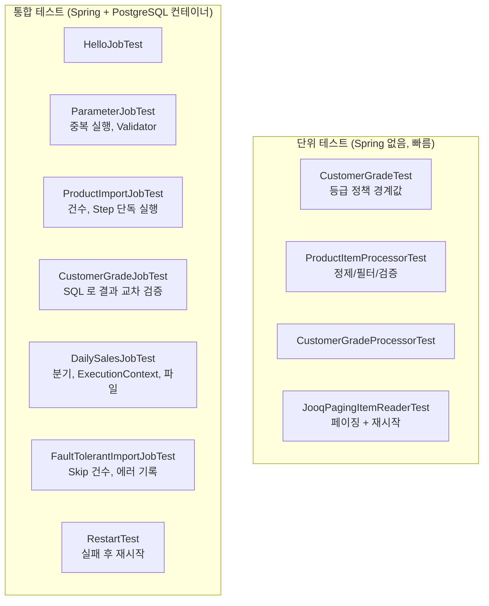

# 09. 배치 테스트

## 학습 목표

- 배치 코드를 **단위 테스트**(정책, Processor, Reader)와 **통합 테스트**(Job/Step 실행)로 나눠 테스트할 수 있다.
- `@SpringBatchTest` 와 `JobOperatorTestUtils` 로 Job 과 Step 을 실행하고 결과를 검증할 수 있다.
- Testcontainers 로 실제 PostgreSQL 에서 테스트할 수 있다.
- 배치 테스트에서 자주 만나는 함정을 피할 수 있다.

테스트 코드: [`src/test/java/com/example/batch`](../src/test/java/com/example/batch)

---

## 1. 무엇을 어떻게 테스트할까?



| 종류 | 대상 | 장점 |
|------|------|------|
| 단위 테스트 | 비즈니스 규칙(등급 정책), Processor, 직접 만든 Reader | 빠르고 경계값 테스트가 쉬움 |
| 통합 테스트 | Job/Step 전체 흐름, SQL, 트랜잭션, Skip/Restart | 실제 DB 동작(트랜잭션 abort, UNIQUE 제약 등)을 검증 |

> **비즈니스 규칙은 Spring Batch 와 분리**해 두면(`CustomerGrade` enum, `ProductItemProcessor`) 대부분의 로직을 빠른 단위 테스트로 검증할 수 있습니다.

```bash
./gradlew test                                      # 전체
./gradlew test --tests '*CustomerGrade*'            # 일부만
open build/reports/tests/test/index.html            # 테스트 리포트
open build/reports/jacoco/test/html/index.html      # 커버리지 리포트
```

---

## 2. 단위 테스트 예시

### 정책 경계값 테스트

```java
@ParameterizedTest(name = "{0}원 -> {1}")
@CsvSource({
        "0, BRONZE",
        "199999, BRONZE",
        "200000, SILVER",
        "499999, SILVER",
        "500000, GOLD",
        "999999, GOLD",
        "1000000, VIP"
})
void 누적_금액_경계값으로_등급을_결정한다(long amount, CustomerGrade expected) {
    assertThat(CustomerGrade.of(amount)).isEqualTo(expected);
}
```

### Reader 재시작 테스트 (06장에서 버그를 잡은 테스트)

```java
@Test
void ExecutionContext_에_저장된_위치부터_다시_읽는다() throws Exception {
    var first = new JooqPagingItemReader<>("testReader", 3, fakeQuery);   // DB 대신 리스트를 자르는 가짜 쿼리
    var context = new ExecutionContext();
    first.open(context);
    first.read(); first.read(); first.read(); first.read();
    first.update(context);           // chunk 커밋 시점에 Step 이 호출하는 것과 같다
    first.close();

    var restarted = new JooqPagingItemReader<>("testReader", 3, fakeQuery);
    restarted.open(context);         // 저장된 위치(read.count=4)부터

    assertThat(readAll(restarted)).containsExactly(5, 6, 7);
}
```

`ItemStream` 의 생명주기(`open` -> `read`... -> `update` -> `close`)를 테스트에서 직접 호출해 Step 이 하는 일을 흉내냅니다.

---

## 3. 통합 테스트 기반 클래스

### Testcontainers 설정

[`support/TestcontainersConfiguration.java`](../src/test/java/com/example/batch/support/TestcontainersConfiguration.java)

```java
@TestConfiguration(proxyBeanMethods = false)
public class TestcontainersConfiguration {

    @Bean
    @ServiceConnection                                   // 컨테이너 접속 정보를 DataSource 에 자동 연결
    PostgreSQLContainer postgresContainer() {
        return new PostgreSQLContainer(DockerImageName.parse("postgres:18.6-alpine"));  // compose.yaml 과 같은 버전
    }
}
```

> Testcontainers 2.x 에서는 PostgreSQL 컨테이너 클래스가 `org.testcontainers.postgresql.PostgreSQLContainer` 로 옮겨졌고, 모듈 이름도 `testcontainers-postgresql` 입니다.

### 공통 기반 클래스

[`support/BatchIntegrationTestSupport.java`](../src/test/java/com/example/batch/support/BatchIntegrationTestSupport.java)

```java
@SpringBootTest(properties = {
        "spring.batch.job.enabled=false",                // 컨텍스트 기동 시 Job 자동 실행 끄기
        "batch.report-dir=build/test-reports/batch"
})
@SpringBatchTest                                         // JobOperatorTestUtils, JobRepositoryTestUtils 등록
@Import(TestcontainersConfiguration.class)
public abstract class BatchIntegrationTestSupport {

    @Autowired protected JobOperatorTestUtils jobOperatorTestUtils;
    @Autowired protected JobRepositoryTestUtils jobRepositoryTestUtils;
    @Autowired protected DSLContext dsl;
    @Autowired private DataSource dataSource;

    @BeforeEach
    void resetDatabase() {
        jobRepositoryTestUtils.removeJobExecutions();    // 메타데이터 삭제 -> 테스트 간 JobInstance 충돌 방지
        new ResourceDatabasePopulator(                   // 도메인 데이터 초기화
                new ClassPathResource("schema.sql"),
                new ClassPathResource("data.sql"))
                .execute(dataSource);
    }
}
```

| 포인트 | 이유 |
|--------|------|
| `spring.batch.job.enabled=false` | 안 끄면 컨텍스트가 뜰 때 `helloJob` 이 실행되어 버린다 |
| `removeJobExecutions()` | 테스트마다 같은 파라미터를 써도 `JobInstanceAlreadyCompleteException` 이 나지 않게 |
| `schema.sql` + `data.sql` 재실행 | Spring 테스트 컨텍스트는 캐시되어 재사용되므로, `spring.sql.init` 은 처음 한 번만 실행된다. 테스트마다 직접 초기화 |
| 컨테이너를 `@Bean` 으로 | 테스트 컨텍스트가 재사용되는 동안 컨테이너도 하나만 뜬다 |

---

## 4. Job 통합 테스트

### 테스트할 Job 지정

컨텍스트에 Job 이 여러 개라서 `JobOperatorTestUtils` 에 어떤 Job 을 실행할지 알려줘야 합니다.

```java
class DailySalesJobTest extends BatchIntegrationTestSupport {

    @Autowired
    private Job dailySalesJob;

    @BeforeEach
    void setUp() {
        jobOperatorTestUtils.setJob(dailySalesJob);
    }
```

### Job 실행과 검증

```java
    @Test
    void 주문이_있는_날은_집계하고_리포트를_만든다() throws Exception {
        JobExecution execution = jobOperatorTestUtils.startJob(params(LocalDate.of(2026, 10, 1)));

        // 1) 상태
        assertThat(execution.getStatus()).isEqualTo(BatchStatus.COMPLETED);
        // 2) 흐름: 어떤 Step 이 어떤 순서로 실행됐나
        assertThat(execution.getStepExecutions())
                .extracting(StepExecution::getStepName)
                .containsExactly("aggregateStep", "reportStep");
        // 3) DB 결과 (jOOQ 로 조회)
        var summary = dsl.fetchSingle(DAILY_SALES_SUMMARY, DAILY_SALES_SUMMARY.SALES_DATE.eq(targetDate));
        assertThat(summary.getTotalAmount()).isEqualTo(3_102_000L);
        // 4) ExecutionContext
        assertThat(execution.getExecutionContext().getLong("totalAmount")).isEqualTo(3_102_000L);
        // 5) 파일
        assertThat(Files.readString(reportDir.resolve("daily-sales-2026-10-01.txt"))).contains("3,102,000원");
    }
```

배치 테스트에서 검증할 것들:

| 검증 대상 | 방법 |
|-----------|------|
| 최종 상태 | `execution.getStatus()`, `getExitStatus()` |
| 실행된 Step / 순서 | `execution.getStepExecutions()` |
| 처리 건수 | `stepExecution.getReadCount()`, `getWriteCount()`, `getFilterCount()`, `getSkipCount()` ... |
| DB 결과 | jOOQ `dsl` 로 직접 조회 |
| Step 간 데이터 | `execution.getExecutionContext()` |
| 예외 | `assertThatThrownBy(() -> startJob(...)).isInstanceOf(JobInstanceAlreadyCompleteException.class)` |

### 결과를 다른 방법으로 교차 검증하기

[`CustomerGradeJobTest`](../src/test/java/com/example/batch/lesson06/CustomerGradeJobTest.java) 는 기대값을 하드코딩하지 않고, **별도의 SQL 로 누적 금액을 계산한 뒤 정책(`CustomerGrade.of`)과 비교**합니다.
데이터가 바뀌어도 테스트가 깨지지 않고, Reader 쿼리의 실수(JOIN 조건 누락 등)도 잡아냅니다.

```java
Map<Long, Long> paidByCustomer = dsl.select(CUSTOMER.ID, coalesce(sum(ORDERS.AMOUNT), val(BigDecimal.ZERO)))
        .from(CUSTOMER)
        .leftJoin(ORDERS).on(ORDERS.CUSTOMER_ID.eq(CUSTOMER.ID).and(ORDERS.STATUS.eq("PAID")))
        .groupBy(CUSTOMER.ID)
        .fetchMap(r -> r.value1(), r -> r.value2().longValue());

gradeByCustomer.forEach((id, grade) ->
        assertThat(grade).isEqualTo(CustomerGrade.of(paidByCustomer.get(id)).name()));
```

### incrementer 가 있는 Job 실행

```java
// 03장 helloJob, 06장 customerGradeJob
JobExecution execution = jobOperatorTestUtils.getJobOperator().startNextInstance(customerGradeJob);
```

`jobOperatorTestUtils.startJob()` 은 `batch.random` 이라는 랜덤 파라미터를 붙여 주지만, incrementer 가 있는 Job 에서는 Spring Batch 6 가 그 파라미터를 무시하고 경고를 남깁니다. (04장)
incrementer 가 있는 Job 은 `startNextInstance()` 로 실행하는 것이 의도에 맞습니다.

### Step 하나만 실행

```java
JobExecution execution = jobOperatorTestUtils.startStep("productImportStep", PRODUCTS_CSV, new ExecutionContext());
```

긴 Job 에서 특정 Step 만 검증하고 싶을 때 씁니다. 앞 Step 이 Job ExecutionContext 에 넣어 줬어야 할 값은 세 번째 인자로 넣어 줄 수 있습니다.

---

## 5. 자주 만나는 함정

### (1) `@SpringBatchTest` 와 "JobExecution 을 반환하는 메서드"

처음에는 기반 클래스에 이런 헬퍼를 만들었습니다.

```java
protected JobExecution launch(Job job, JobParameters params) throws Exception { ... }   // 이러면 안 된다!
```

그랬더니 **모든 통합 테스트가 실패**했습니다.

```
java.lang.IllegalArgumentException at JobScopeTestExecutionListener.java:134
    Caused by: java.lang.IllegalArgumentException at HippyMethodInvoker.java:80
```

`@SpringBatchTest` 가 등록하는 `JobScopeTestExecutionListener` / `StepScopeTestExecutionListener` 는 테스트 클래스에서 **`JobExecution`(또는 `StepExecution`)을 반환하는 메서드를 찾아 "테스트용 실행 컨텍스트 팩토리"로 호출**합니다. (`@JobScope` / `@StepScope` 빈을 테스트에서 직접 주입받을 때 쓰는 기능)
인자가 있는 메서드를 인자 없이 호출하려다 실패한 것입니다.

> **해결**: 테스트 클래스(와 부모 클래스)에 `JobExecution` / `StepExecution` 을 반환하는 헬퍼 메서드를 만들지 않는다.
> `jobOperatorTestUtils.setJob(...)` + `startJob(...)` 을 그대로 쓴다.

### (2) 테스트 간 데이터 오염

통합 테스트들은 같은 DB 를 공유합니다. 한 테스트가 고객 등급을 바꾸면 다음 테스트에 영향을 줍니다.
-> `@BeforeEach` 에서 메타데이터와 도메인 데이터를 초기화합니다.

### (3) `@Transactional` 테스트 롤백을 쓰면 안 된다

웹 테스트처럼 `@Transactional` 을 붙여 테스트 후 롤백하려 하면 안 됩니다.
Step 은 **자기 트랜잭션을 직접 열고 커밋**하기 때문에 테스트 트랜잭션과 충돌합니다. (JobRepository 가 "이미 트랜잭션이 있다"는 오류를 냅니다)
-> 데이터 초기화는 위처럼 명시적으로 합니다.

---

## 6. 실습

1. `./gradlew test` 를 실행하고 `build/reports/tests/test/index.html` 에서 결과를 확인하자.
2. `build/reports/jacoco/test/html/index.html` 에서 커버리지를 확인하자. (jOOQ 생성 코드는 제외)
3. 08장의 `ProductImportSkipListener` 에서 `REQUIRES_NEW` 를 제거하고 `FaultTolerantImportJobTest` 가 실패하는 것을 확인하자.
4. `ProductImportJobTest` 에 "가격이 음수인 줄이 있으면 Step 이 FAILED 가 된다"는 테스트를 추가해 보자. (힌트: `@TempDir` 로 CSV 를 만들어 `inputFile=file:...` 로 전달. `RestartTest` 참고)

---

## 정리

- 비즈니스 규칙은 프레임워크와 분리해 **단위 테스트**, Job/Step 흐름과 SQL 은 **Testcontainers 통합 테스트**.
- `@SpringBatchTest` + `JobOperatorTestUtils.setJob()` + `startJob()` / `startStep()` 으로 실행하고, 상태 / Step 흐름 / 건수 / DB / ExecutionContext 를 검증한다.
- 테스트마다 메타데이터와 도메인 데이터를 초기화하고, `@Transactional` 롤백에 기대지 않는다.
- 테스트 클래스에 `JobExecution` 을 반환하는 메서드를 만들지 않는다.

## 확인 문제

1. `spring.batch.job.enabled=false` 를 빼면 테스트에서 어떤 일이 생길까?
2. 기대값을 하드코딩하는 테스트와, 별도 쿼리로 교차 검증하는 테스트의 장단점은?
3. Step 단독 실행(`startStep`)은 어떤 상황에서 유용할까?

---

[← 이전: 08. 내결함성: Skip / Retry](08-fault-tolerance.md) | [목차](../README.md) | [다음: 10. 운영과 다음 단계 →](10-operations-and-next-steps.md)
