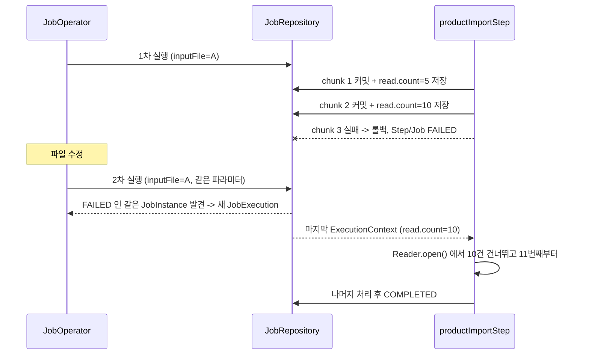
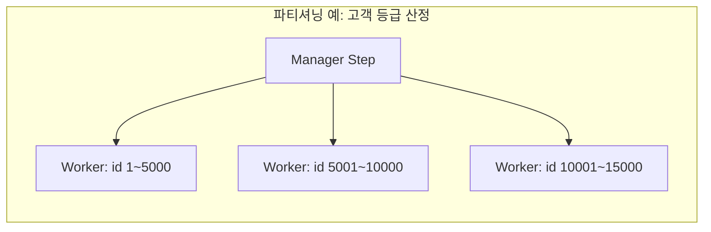

# 10. 운영과 다음 단계

## 학습 목표

- 실패한 Job 을 **재시작**해서 실패한 지점부터 이어서 처리할 수 있다.
- 배치 애플리케이션을 jar 로 실행하고 스케줄러와 연동하는 방법을 안다.
- 성능을 높이는 방법(chunk size, 멀티 스레드, 파티셔닝, keyset 페이징)의 종류와 trade-off 를 안다.
- 운영 체크리스트로 배치 코드를 점검할 수 있다.

---

## 1. 재시작 (Restart)

### 원리



재시작이 되려면 세 가지가 맞아야 합니다.

1. **같은 JobInstance**: 같은 식별 파라미터로 실행 (incrementer 가 있으면 안 됨 -> 04장)
2. **Reader 가 상태를 저장**: `ItemStream` 을 구현하고 `name` 이 있어야 한다 (`FlatFileItemReader`, `JooqPagingItemReader` 모두 해당)
3. **이미 커밋된 결과는 그대로**: 1 ~ 10번째 상품은 DB 에 남아 있어야 한다

### 실습: bootRun 으로 재시작해 보기

이 프로젝트는 기동할 때마다 `schema.sql` 이 테이블을 초기화하므로, **재시작할 때는 `--spring.sql.init.mode=never`** 로 데이터를 보존합니다.

```bash
# 1) 13번째 상품 가격을 -1 로 바꾼 파일 준비
sed 's/^p-013,사은품 스티커,0,1000$/p-013,사은품 스티커,-1,1000/' \
    src/main/resources/input/products.csv > /tmp/restart-products.csv

# 2) 첫 실행 -> FAILED
./gradlew bootRun --args='--spring.batch.job.name=productImportJob inputFile=file:/tmp/restart-products.csv'
```

```
<<< [productImportJob] 종료 - status=FAILED, exitStatus=FAILED
    - step=productImportStep status=FAILED read=15 filter=0 write=10 skip=0 commit=2 rollback=1
```

```bash
docker exec hello-batch-postgres psql -U batch -d batch -tAc "select count(*) from product"   # 10

# 3) 파일을 고치고, 같은 파라미터로 다시 실행 (데이터 초기화 없이)
cp src/main/resources/input/products.csv /tmp/restart-products.csv
./gradlew bootRun --args='--spring.batch.job.name=productImportJob inputFile=file:/tmp/restart-products.csv --spring.sql.init.mode=never'
```

```
<<< [productImportJob] 종료 - status=COMPLETED, exitStatus=COMPLETED
    - step=productImportStep status=COMPLETED read=12 filter=2 write=10 skip=0 commit=3 rollback=0
```

```bash
docker exec hello-batch-postgres psql -U batch -d batch -tAc "select count(*) from product"   # 20
```

두 번째 실행은 **11번째 줄부터 12건만 읽었고**, 중복 없이 전체 20건이 적재되었습니다.
같은 시나리오가 [`RestartTest`](../src/test/java/com/example/batch/lesson10/RestartTest.java) 에 자동화되어 있습니다.

```sql
-- 같은 JobInstance 에 JobExecution 이 2개
SELECT i.job_instance_id, e.job_execution_id, e.status
FROM batch_job_instance i JOIN batch_job_execution e USING (job_instance_id)
WHERE i.job_name = 'productImportJob' ORDER BY e.job_execution_id;
```

### 재시작 관련 설정

| 설정 | 의미 |
|------|------|
| `JobBuilder.preventRestart()` | 이 Job 은 재시작 불가 (실패하면 새 파라미터로 처음부터) |
| `StepBuilder.allowStartIfComplete(true)` | 재시작 시 이미 COMPLETED 인 Step 도 다시 실행 (기본은 건너뜀) |
| `StepBuilder.startLimit(n)` | 이 Step 이 시작될 수 있는 최대 횟수 |
| Reader 의 `setSaveState(false)` | 위치를 저장하지 않음 -> 재시작 시 처음부터 읽음 (멀티 스레드 Step 에서 필요) |

> **여러 Step 으로 된 Job 을 재시작하면** COMPLETED 된 Step 은 건너뛰고 FAILED 된 Step 부터 실행합니다.
> 07장 `dailySalesJob` 에서 `reportStep` 만 실패했다면 재시작 시 `reportStep` 만 다시 실행됩니다.

### 비정상 종료 (kill, OOM, 서버 다운)

프로세스가 갑자기 죽으면 JobExecution 이 `STARTED` 상태로 남습니다. 이 상태에서는 "이미 실행 중"으로 보여서 재시작이 안 됩니다.
Spring Batch 6 의 `JobOperator.recover(jobExecution)` 로 FAILED 상태로 정리한 뒤 재시작합니다.
(실제로 실행 중인지 반드시 먼저 확인해야 합니다)

---

## 2. 실행과 스케줄링

### jar 로 실행

```bash
./gradlew bootJar
docker compose up -d       # jar 에는 spring-boot-docker-compose 가 포함되지 않으므로 DB 를 먼저 띄운다
java -jar build/libs/hello-spring-batch-0.0.1-SNAPSHOT.jar \
     --spring.batch.job.name=dailySalesJob targetDate=2026-10-01,java.time.LocalDate
echo $?                    # 0 = 성공, 그 외 = 실패
```

### 스케줄러 선택

| 방식 | 특징 |
|------|------|
| cron + `java -jar` | 가장 단순. 서버 1대 운영 시 |
| Kubernetes CronJob | 컨테이너 이미지로 배포, 실행마다 Pod 생성. 종료 코드로 성공/실패 판단 |
| Jenkins / Airflow / Argo Workflows | Job 간 의존 관계, 재실행 UI, 알림 |
| 애플리케이션 내부 `@Scheduled` | 서버가 여러 대면 **중복 실행** 위험. 쓰려면 분산 락(ShedLock 등) 필요 |

이 강의 구조처럼 **"한 번 실행하고 종료되는 프로세스"** 로 만들면 어떤 스케줄러와도 쉽게 연동됩니다.
`main()` 의 `System.exit(SpringApplication.exit(...))` 가 Job 결과를 종료 코드로 돌려주는 것이 핵심입니다.

> 같은 JobInstance 를 동시에 두 번 실행하면 두 번째는 `JobExecutionAlreadyRunningException` 으로 막힙니다.
> 하지만 incrementer Job 은 매번 다른 JobInstance 라서 **동시에 여러 개가 돌 수 있습니다.** 스케줄러 쪽에서 동시 실행을 막아야 합니다. (예: Kubernetes CronJob 의 `concurrencyPolicy: Forbid`)

---

## 3. 성능 높이기

먼저 **측정**합니다. `JobSummaryListener` 로그의 elapsed, `BATCH_STEP_EXECUTION` 의 `start_time` / `end_time`, 건수를 보고 병목을 찾습니다.

| 방법 | 설명 | 주의 |
|------|------|------|
| chunk size 조정 | 커밋 횟수와 DB 왕복을 줄인다 | 너무 크면 롤백 범위/메모리 증가 |
| Writer 일괄 처리 | multi-row INSERT, `dsl.batch()` (05, 06장) | PostgreSQL JDBC 는 URL 에 `reWriteBatchedInserts=true` 를 주면 batch INSERT 가 더 빨라진다 |
| Keyset(No-Offset) 페이징 | `WHERE id > :lastId ORDER BY id LIMIT n` | OFFSET 이 커질수록 느려지는 문제 해결. 마지막 id 를 ExecutionContext 에 저장해야 재시작 가능 |
| 집계는 SQL 로 | 07장처럼 DB 가 잘하는 일(`GROUP BY`)은 DB 에 맡긴다 | Java 로 전부 읽어서 합치지 않기 |
| 멀티 스레드 Step | `ChunkOrientedStepBuilder.taskExecutor(...)` 로 chunk 를 병렬 처리 | Reader 가 thread-safe 해야 하고 순서가 보장되지 않음, 재시작이 어려움 |
| 파티셔닝 | `StepBuilder.partitioner(...)` 로 데이터를 범위(예: id 구간, 날짜)로 나눠 여러 Step 이 병렬 처리 | 파티션별로 상태가 저장되어 재시작 가능. 설계가 조금 복잡 |
| 인덱스 | Reader 쿼리의 WHERE / ORDER BY 컬럼 | `EXPLAIN ANALYZE` 로 확인 |



---

## 4. 운영 체크리스트

배치 코드를 리뷰할 때 아래 질문을 던져 보세요.

| 질문 | 관련 장 |
|------|---------|
| JobInstance 의 식별 파라미터는 무엇인가? (날짜? 파일? incrementer?) | 04 |
| 같은 파라미터로 두 번 실행되면 어떻게 되는가? 결과가 멱등한가? | 04, 07 |
| 중간에 실패하면 재시작할 수 있는가? Reader 가 상태를 저장하는가? | 06, 10 |
| 페이징 Reader 의 정렬이 고유한가? 읽는 조건을 같은 Step 에서 바꾸지 않는가? | 06 |
| chunk size 는 측정해서 정했는가? | 05 |
| 어떤 예외를 skip / retry 하는가? 너무 넓게 잡지 않았는가? skipLimit 은? | 08 |
| skip 된 데이터는 어디에 기록되는가? 롤백되어도 남는가? | 08 |
| 실패 시 누가 어떻게 알게 되는가? (종료 코드, 알림) | 03, 10 |
| 운영 DB 에서 `spring.sql.init` / `initialize-schema=always` 를 껐는가? | 02 |
| 메타데이터 테이블은 주기적으로 정리하는가? (오래된 이력 삭제) | 04 |
| 테스트: 정상 / 빈 데이터 / 불량 데이터 / 재시작 시나리오가 있는가? | 09 |

---

## 5. 다음에 해 볼 것

이 강의의 코드를 확장하면서 연습해 보세요.

1. **Keyset 페이징 Reader**: `JooqPagingItemReader` 를 `WHERE id > lastId` 방식으로 바꾸고, `lastId` 를 ExecutionContext 에 저장해 재시작을 지원해 보자. 재시작 테스트도 작성하자.
2. **파일 출력**: `FlatFileItemWriterBuilder` 로 `daily_sales_summary` 를 CSV 로 내보내는 Job 을 만들어 보자.
3. **알림 Step**: 07장 `dailySalesJob` 에 `.on("FAILED").to(alertStep).fail()` 흐름을 추가해 보자.
4. **파티셔닝**: 06장 고객 등급 Job 을 id 범위로 파티셔닝해 보자.
5. **Flyway 도입**: `schema.sql` 대신 Flyway 마이그레이션으로 바꾸고, jOOQ 코드 생성을 Testcontainers + Flyway 기반으로 바꿔 보자.
6. **관측(Observability)**: Spring Boot Actuator + Micrometer 로 Job/Step 실행 시간을 메트릭으로 수집해 보자. (Spring Batch 는 Micrometer Observation 을 지원한다)

### 참고 자료

- [Spring Batch Reference Documentation](https://docs.spring.io/spring-batch/reference/)
- [Spring Batch 6.0 What's New / Migration Guide](https://github.com/spring-projects/spring-batch/wiki)
- [Spring Boot Reference - Batch Applications](https://docs.spring.io/spring-boot/how-to/batch.html)
- [jOOQ Manual](https://www.jooq.org/doc/latest/manual/)
- [Testcontainers for Java](https://java.testcontainers.org/)

---

## 강의를 마치며

| 장 | 핵심 한 줄 |
|----|-----------|
| 01 | Job 은 Step 의 묶음, JobInstance = Job + 식별 파라미터 |
| 02 | `schema.sql` 하나로 테이블 생성과 jOOQ 코드 생성 |
| 03 | Tasklet 은 한 번 실행되는 단순 작업 |
| 04 | 파라미터 설계가 곧 중복 실행 방지와 재시작 설계 |
| 05 | Chunk = N건 읽기 -> 가공 -> 한 번에 쓰기 -> 커밋 |
| 06 | 직접 만든 Reader 는 재시작 테스트 필수 |
| 07 | 조건 분기는 Decider, Step 간 데이터는 ExecutionContext, 집계는 멱등하게 |
| 08 | 데이터 문제는 Skip, 일시적 문제는 Retry, 에러 기록은 별도 트랜잭션 |
| 09 | 규칙은 단위 테스트, 흐름은 Testcontainers 통합 테스트 |
| 10 | 실패한 지점부터 재시작, 한 번 실행하고 종료되는 프로세스 |

---

[← 이전: 09. 배치 테스트](09-testing.md) | [목차](../README.md) | [처음으로: README](../README.md)
